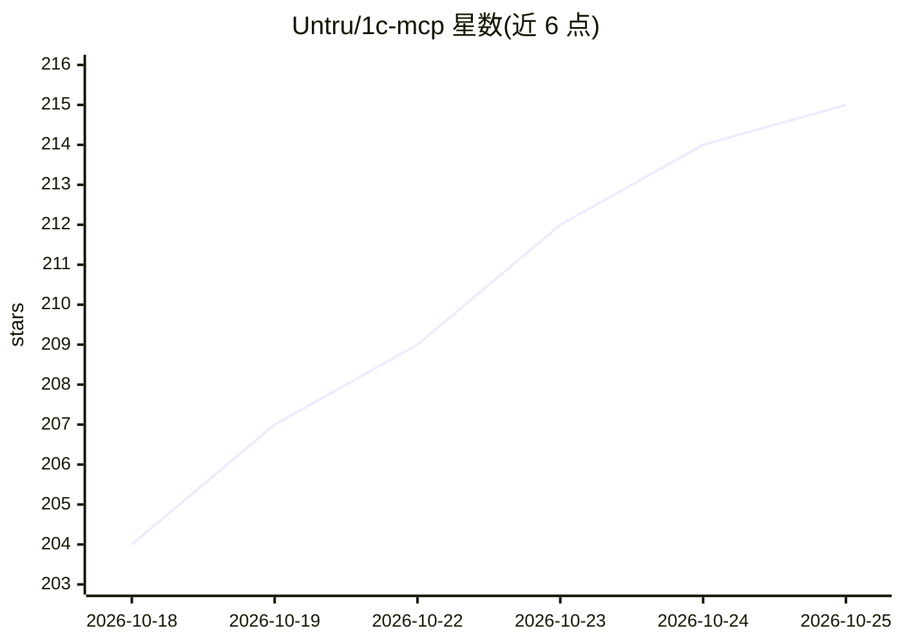

# Untru/1c-mcp

⭐ 215 · Python · 推送 2026-10-19 · [GitHub](https://github.com/Untru/1c-mcp) · 个人维护

**1C:Enterprise 生态 MCP 服务器策展清单：接入 AI 助手与 1С**

面向 1С:Предприятие 开发生态的 awesome 清单，收录 MCP 服务器、插件与 skills 集合，用于把 AI 助手（Claude Code、Codex、Cursor、VS Code Copilot 等）接入 1С：读取配置元数据、查询数据库、代码分析、运行测试等。条目按 IDE 集成、活库与框架、元数据与代码分析等分类组织，每条标注技术栈、MCP 传输方式、平台要求与维护状态（稳定/测试/实验/停更）。提供按任务选型的“从哪开始”对照表与每周自动更新的星标排行。

## 筛选速览

| 维度 | 判定 | 备注 |
|---|---|---|
| AI 角色 | `ai-knowledge` | 知识聚合/清单类 |
| 许可风险 | `none` | — |
| 部署形态 | `self-host` | docker 或自建部署 |
| 模型依赖 | — | README 未给出锁定关系 |
| 硬件要求 | — | 无带数字的原话,不猜 |
| 安装摩擦 | `low` | 无编译、无系统依赖或容器化 |
| 成熟度 | — | 结构信号不足 |

## 能力要点

- 按 IDE 集成/活库框架/元数据分析等类别组织的 MCP 服务器目录
- 每条目标注技术栈、MCP 传输方式、平台要求与维护状态
- 提供按开发任务（EDT/VS Code/活库/测试）的选型对照表
- 星标排行表由 workflow 每周自动重建

## 适用场景

- 为 1С 开发挑选接入 AI 助手的 MCP 服务器或 skills
- 在 EDT 或 VS Code/Cursor 中接入 1С 平台能力
- 了解 1С 生态 MCP 工具的覆盖范围与维护状态

## 场景标签

`精选清单` · 领域:学习与行业

## 证据(README 行号)

> L6: Каталог MCP-серверов, плагинов и наборов skills, которые подключают AI-ассистентов (Claude Code, Codex, Cursor, VS C
> L8: **Зачем это всё.** Сама по себе нейросеть про вашу 1С ничего не знает: не видит метаданные, путает методы платформы,

## 星数曲线

2026-10-18 204 → 2026-10-25 215（+11）

---
*卡片 v1 · prompt 1.4 · 生成 2026-10-22 · 置信度 mid · 依据 README sha `fde4285b37b9` · [字段定义](../../DATASET.md)*
