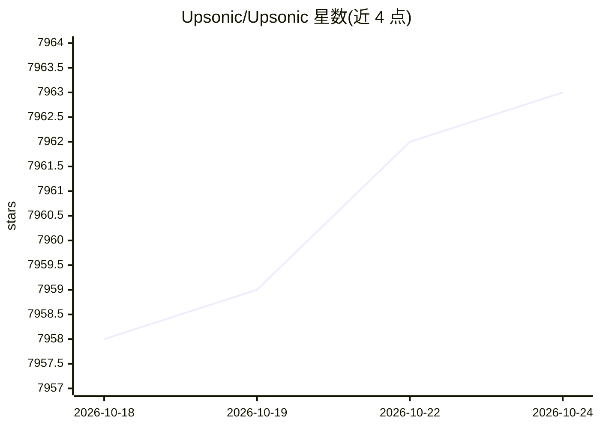

# Upsonic/Upsonic

⭐ 7,962 · Python · MIT · 推送 2026-06-18 · [GitHub](https://github.com/Upsonic/Upsonic) · [官网](https://docs.upsonic.ai) · 组织维护

**Python 自主 Agent 构建框架，含 OCR 与预置 Agent**

用于构建自主 Agent（如 OpenClaw、Claude Cowork 形态）与传统 Agent 系统的 Python 框架。提供 AutonomousAgent 与 Agent 抽象、自定义工具注册、MCP 工具集成说明、E2B 沙箱接入的下一步指引，以及社区预置 Agent 集合（含技能、系统提示与首条消息）。自主 Agent 的文件与 shell 操作限制在 workspace 内并阻断路径穿越。另提供统一 OCR 分层管线，支持 EasyOCR、RapidOCR、Tesseract、PaddleOCR、DeepSeek 系引擎。以 pip 包分发，MIT 许可。

## 筛选速览

| 维度 | 判定 | 备注 |
|---|---|---|
| AI 角色 | `ai-ecosystem` | LLM/agent 周边工具 |
| 许可风险 | `permissive` | MIT |
| 部署形态 | `library` | 以包/库形式分发 |
| 模型依赖 | local-ok | 支持本地模型 |
| 硬件要求 | — | 无带数字的原话,不猜 |
| 安装摩擦 | `low` | 无编译、无系统依赖或容器化 |
| 成熟度 | — | 结构信号不足 |

## 能力要点

- AutonomousAgent 与传统 Agent 双形态 API
- 文件/shell 操作限制在 workspace，阻断路径穿越与危险命令
- 社区预置自主 Agent（技能+系统提示+首条消息）
- 统一 OCR 分层管线，支持 6 种引擎可选装

## 适用场景

- 用 Python 快速搭建自主或传统 LLM Agent
- 为 Agent 接入自定义工具与 MCP 外部数据源
- 在应用中做文档 OCR 处理
- 复用社区预置 Agent 快速起步

## 场景标签

`Agent 框架` `OCR` · 领域:Agent 开发

## 证据(README 行号)

> L19: Upsonic is a Python framework for building autonomous agents like OpenClaw and Claude Cowork, as well as more tradi
> L64: agent = Agent(model="anthropic/claude-sonnet-4-5", name="Stock Analyst Agent")

## 星数曲线

2026-10-18 7,958 → 2026-10-24 7,963（+5）

---
*卡片 v1 · prompt 1.4 · 生成 2026-10-20 · 置信度 high · 依据 README sha `861e0278f235` · [字段定义](../../DATASET.md)*
