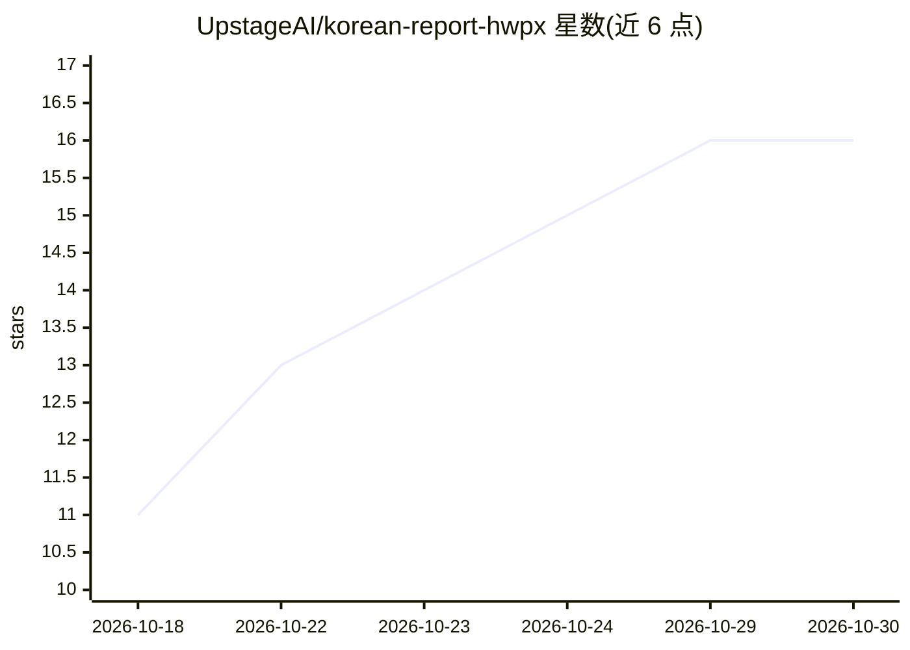

# UpstageAI/korean-report-hwpx

⭐ 16 · Python · MIT · 推送 2026-10-29 · [GitHub](https://github.com/UpstageAI/korean-report-hwpx) · [官网](https://pypi.org/project/korean-report-hwpx/) · 组织维护 · 中文 README

**韩国公文 HWPX 生成 MCP 服务器：52 个机构格式报告与新闻稿**

Upstage 维护的 MCP 服务器，供 Claude·ChatGPT 等 AI 通过工具调用将备忘或草稿整理为韩国政府机构格式的 HWPX 文档：报告（42 个机构规则）、新闻稿（52 个机构）、按行政业务规定别纸第1号书式的公文。提供写作指南查询、结构校验、文档生成（含简化模式与 Markdown 同步导出）等工具，格式规则来自政策简报 2,670 份新闻稿全量解析。全程本地处理，无外部 API 调用，无需 API key。开发者为 Upstage 公司员工个人（Mia/윤승미），MIT 许可。

## 筛选速览

| 维度 | 判定 | 备注 |
|---|---|---|
| AI 角色 | `ai-ecosystem` | LLM/agent 周边工具 |
| 许可风险 | `permissive` | MIT |
| 部署形态 | `library` | 以包/库形式分发 |
| 模型依赖 | — | README 未给出锁定关系 |
| 硬件要求 | — | 无带数字的原话,不猜 |
| 安装摩擦 | `low` | 无编译、无系统依赖或容器化 |
| 成熟度 | — | 结构信号不足 |

## 能力要点

- 支持 52 个韩国中央行政机构的报告·新闻稿格式与别纸第1号书式公文
- 格式规则基于政策简报 2,670 份新闻稿 HWPX 全量解析实测
- 全程本地处理，不调用外部 API，无需 API key
- 简化模式自动编号层级并同步导出 Markdown

## 适用场景

- 公务员将会议备忘整理为机构格式报告或新闻稿
- 通过 Claude 等 AI 对话生成公文并按机构规则校验
- 查询各机构层级符号·字体·字号等格式规则

## 场景标签

`AI 写作` · 领域:内容生成

## 证据(README 行号)

> L9: **공무원 공문서(보고서·보도자료)를 기관 서식 HWPX로.** 쓰고 있는 AI(Claude·ChatGPT 등)가 메모·초안을 공문서 구조로 정리하면, 52개 중앙행정기관의 서식 규칙값으로 한글(HWPX) 파
> L23: **설치 한 줄** — `claude mcp add korean-report-hwpx -- uvx korean-report-hwpx`
> L33: **사용 흐름** — AI에게 "이 메모를 ○○부 보고서로 만들어 줘" → AI가 `get_writing_guide`로 작성 규칙 확인 → 원고를 구조 JSON으로 작성 → `build_document` →

## 星数曲线

2026-10-18 11 → 2026-10-30 16（+5）

---
*卡片 v1 · prompt 1.4 · 生成 2026-10-30 · 置信度 high · 依据 README sha `5167e0206066` · [字段定义](../../DATASET.md)*
