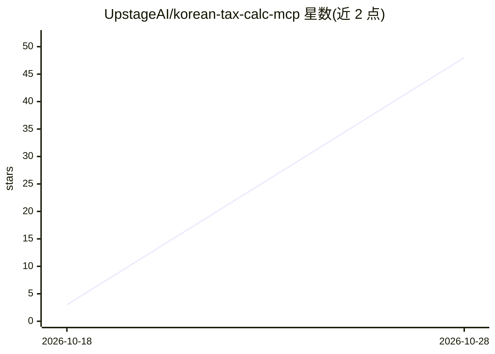

# UpstageAI/korean-tax-calc-mcp

⭐ 85 · Python · MIT · 推送 2026-10-28 · [GitHub](https://github.com/UpstageAI/korean-tax-calc-mcp) · [官网](https://pypi.org/project/korean-tax-calc-mcp/) · 组织维护

**韩国税务计算 MCP 服务器：为 AI agent 提供税额计算与税务调整工具**

由 Upstage 维护的 Model Context Protocol 服务器，向 AI agent 提供 76 个韩国税务计算与判定工具：输入年度、金额与账簿项目，按法人税、所得税、增值税、加算税、税务调整等类别输出税额、中间计算、所得处分及依据法条。计算判定工具 73 个以代码本地运行，不使用生成式 AI；仅 3 个 PDF 表格提取工具在配置 UPSTAGE_API_KEY 时调用 Upstage Solar Pro 4，无密钥时回退 pypdf 本地提取。税率年度表覆盖 2016–2026，表外年度报错不估算。声明不构成税务代理。

## 筛选速览

| 维度 | 判定 | 备注 |
|---|---|---|
| AI 角色 | `ai-ecosystem` | LLM/agent 周边工具 |
| 许可风险 | `permissive` | MIT |
| 部署形态 | `library` | 以包/库形式分发 |
| 模型依赖 | — | README 未给出锁定关系 |
| 硬件要求 | — | 无带数字的原话,不猜 |
| 安装摩擦 | `low` | 无编译、无系统依赖或容器化 |
| 成熟度 | — | 结构信号不足 |

## 能力要点

- 76 个工具覆盖法人税/所得税/增值税/加算税/税务调整/税务调查判定
- 73 个计算工具本地代码运行，每项结果附依据法条与计算式
- 无年度表的年度直接报错，不做估算计算
- export_workbook 可生成法定书式样式的审查用 Excel

## 适用场景

- 让 AI agent 按韩国税法计算法人税、所得税与增值税
- 把账簿项目直接交给 agent 完成项目判定到税务调整
- 生成附法条依据的计算过程 Excel 用于专业复核

## 场景标签

`数据分析` · 领域:效率与自动化

## 证据(README 行号)

> L1: # korean-tax-calc-mcp — Korea Tax Calculator MCP (한국 세금 계산)
> L9: **Korean tax calculations for AI agents — code, not guesses.** English
> L29: 계산·판정 도구 73개는 생성형 AI 없이 내 PC에서 동작합니다. PDF 도구 3개만 `UPSTAGE_API_KEY`가 있을 때 Upstage를 씁니다.

## 星数曲线

2026-10-18 3 → 2026-10-28 48（+45）

---
*卡片 v1 · prompt 1.4 · 生成 2026-10-28 · 置信度 high · 依据 README sha `f656e1fbabbe` · [字段定义](../../DATASET.md)*
