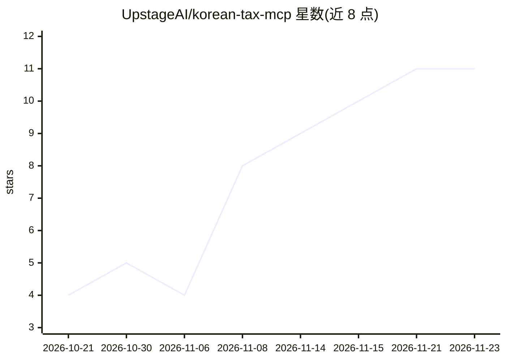

# UpstageAI/korean-tax-mcp

⭐ 11 · Python · MIT · 推送 2026-11-20 · [GitHub](https://github.com/UpstageAI/korean-tax-mcp) · [官网](https://upstageai.github.io/korean-tax-mcp/) · 组织维护

**韩国税法 MCP 服务器：为 AI 代理提供带出处的税法依据检索**

一个面向 AI 代理的韩国税法 MCP 服务器，提供 54 个工具（53 个只读，1 个生成 Word 备忘录）：按任意基准日检索现行法条原文、国税厅解释·判例·税务审判院审决、96 国税收协定及限制税率、居民身份三阶段判定、常设机构（PE）判定、转让定价文档与要件指引（2016~2026 年度）。多数工具无需 API key，法条查询与审决检索需 LAW_OC key。所有工具支持 lang="en" 输出英文结果。配套 korean-tax-calc-mcp 负责金额计算与法定书式，本服务器不进行税务咨询。

## 筛选速览

| 维度 | 判定 | 备注 |
|---|---|---|
| AI 角色 | `ai-ecosystem` | LLM/agent 周边工具 |
| 许可风险 | `permissive` | MIT |
| 部署形态 | `library` | 以包/库形式分发 |
| 模型依赖 | — | README 未给出锁定关系 |
| 硬件要求 | — | 无带数字的原话,不猜 |
| 安装摩擦 | `low` | 无编译、无系统依赖或容器化 |
| 成熟度 | — | 结构信号不足 |

## 能力要点

- 54 个 MCP 工具：法条·解释·判例·条约·要件指引检索与引用核验
- 按基准日返回当时施行的法条原文、附则与附表
- 96 国税收协定文本与股息·利息·特许权使用费限制税率
- 工具均支持 lang="en" 英文结果，多数无需 API key

## 适用场景

- 在 Claude 等 AI 代理中检索带文档号与链接的韩国税法依据
- 跨国企业与外派人员查询居民判定、PE 判定与条约税率
- 按课税年度核对税额抵扣·减免的适用要件
- 逐字比对陈述与法条原文、核验草稿中的引用

## 场景标签

`科研工具` · 领域:学习与行业

## 证据(README 行号)

> L1: # korean-tax-mcp — Korea Tax Law MCP (한국 세법)
> L5: 세법 쟁점을 AI에 물으면 **그 시점에 시행 중이던 조문과 국세청 해석·판례·조세심판원 재결례를 문서번호·링크와 함께** 가져오는 MCP 서버입니다(도구 54개 — 53개는 읽기 전용, `build_tax_
> L16: claude mcp add korean-tax -- uvx korean-tax-mcp

## 星数曲线

2026-10-21 4 → 2026-11-23 11（+7）

---
*卡片 v1 · prompt 1.4 · 生成 2026-11-20 · 置信度 high · 依据 README sha `5580ff2df05c` · [字段定义](../../DATASET.md)*
