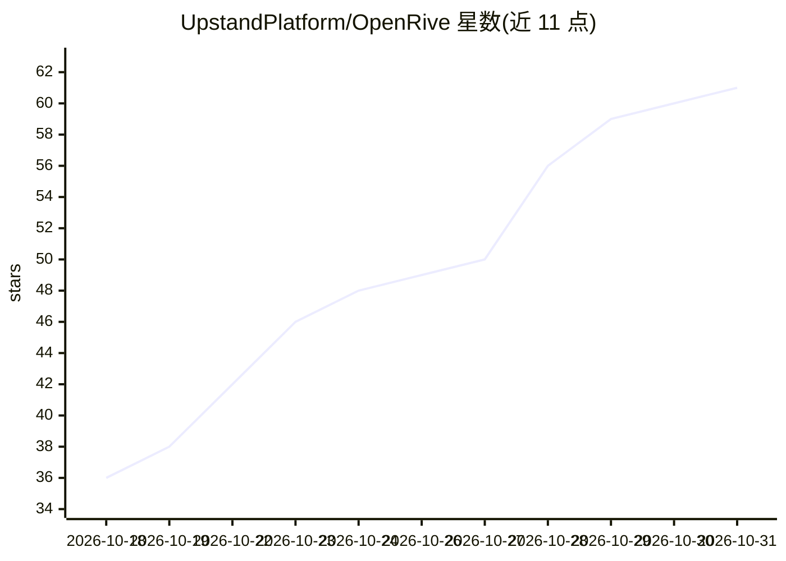

# UpstandPlatform/OpenRive

⭐ 61 · TypeScript · MIT · 推送 2026-10-23 · [GitHub](https://github.com/UpstandPlatform/OpenRive) · [官网](https://openrive.upstand.dev) · 组织维护

**开源本地优先的 Rive .riv 动画编辑器，支持 AI 助手接入**

开源的 Rive 动画编辑器：读写真实 .riv 运行时格式（未修改文件可逐字节往返，经 437 个运行时测试文件校验），画布由官方 Rive WASM 运行时渲染。功能覆盖设计、时间线动画、状态机、数据绑定、主题色与自动化脚本。项目存储在内嵌 PostgreSQL（自托管时用服务器数据库），本地用户与角色替代账号体系。提供 Web 应用、Electrobun 桌面版、终端 UI/CLI、REST API，以及带 42 个工具的 MCP server 供 AI 助手调用；描述中提到可由 AI agent 通过 CLI 生成创作。需 Bun 1.4+ 从源码运行，或使用预编译安装包与 Docker 镜像。

## 筛选速览

| 维度 | 判定 | 备注 |
|---|---|---|
| AI 角色 | `ai-enhanced` | 去掉 AI 部分产品仍成立 |
| 许可风险 | `permissive` | MIT |
| 部署形态 | `self-host` | docker 或自建部署 |
| 模型依赖 | — | README 未给出锁定关系 |
| 硬件要求 | — | 无带数字的原话,不猜 |
| 安装摩擦 | `low` | 无编译、无系统依赖或容器化 |
| 成熟度 | — | 结构信号不足 |

## 能力要点

- 读写真实 .riv 格式，未修改文件逐字节往返，对照 437 个运行时测试文件校验
- MCP server（42 个工具）+ REST API + CLI，供 AI 助手与自动化接入
- Web / 桌面（Electrobun）/ 终端 UI 共享同一编辑核心
- 预览可导出为独立 bundle（index.html + runtime）随处播放

## 适用场景

- 本地或自托管环境设计、制作 Rive 动画与状态机
- 让 AI 助手通过 MCP 或 CLI 操作动画项目
- 为 Web、React、Flutter、iOS、Android 生成嵌入代码并导出 .riv 文件

## 场景标签

 · 领域:创意工具/动画与交互设计

## 证据(README 行号)

> L30: - **Everywhere you work.** A web app, a desktop build (Electrobun), a terminal UI, an MCP server for AI assistants 
> L48: |**Tools**|`openrive` terminal UI and CLI, MCP server (42 tools), REST API, Docker, desktop builds|

## 星数曲线

2026-10-18 36 → 2026-10-31 61（+25）

---
*卡片 v1 · prompt 1.4 · 生成 2026-10-25 · 置信度 high · 依据 README sha `28ce5ed90f97` · [字段定义](../../DATASET.md)*
