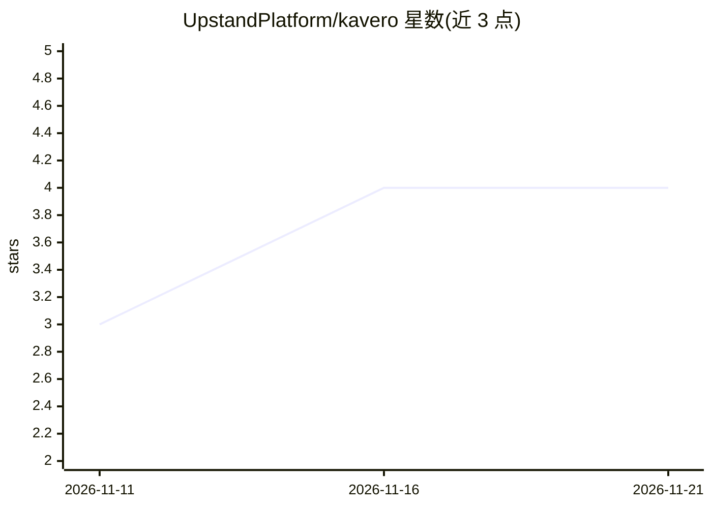

# UpstandPlatform/kavero

⭐ 4 · TypeScript · MIT · 推送 2026-11-18 · [GitHub](https://github.com/UpstandPlatform/kavero) · [官网](https://kavero.upstand.dev) · 个人维护

**面向卖家的 AI 原生产品目录与演示文稿构建器**

Kavero 将产品数据（粘贴、从 MCP 服务器导入或由 AI 生成）转为可视化幻灯片，支持编辑、动画及导出为 PDF、可编辑 PowerPoint、JPG、MP4、单文件 HTML 或发布网站。本地优先，无账号可用；登录后支持跨设备同步、工作区协作与 MCP 服务端（29 个工具）供 AI agent 建目录。内建 AI 聊天与幻灯片编辑提案（before/after 预览），基于 Vercel AI SDK。需 Bun 与 Docker（Postgres/Redis），PDF/视频导出需 Chrome。MIT 许可。

## 筛选速览

| 维度 | 判定 | 备注 |
|---|---|---|
| AI 角色 | `ai-native` | 本体是模型或模型工具 |
| 许可风险 | `permissive` | MIT |
| 部署形态 | `self-host` | docker 或自建部署 |
| 模型依赖 | locked-api |  |
| 硬件要求 | — | 无带数字的原话,不猜 |
| 安装摩擦 | `low` | 无编译、无系统依赖或容器化 |
| 成熟度 | — | 结构信号不足 |

## 能力要点

- 可视化幻灯片编辑器，含产品卡片、Morph 过渡与动画
- AI 聊天与幻灯片编辑提案，支持 Anthropic/OpenRouter/OpenAI/本地模型，未配置模型时内建 planner 接管
- 双向 MCP：导入产品数据 + 29 工具服务端供 agent 操作目录
- 一份文档导出 PDF/PPTX/MP4(4K)/JPG/HTML/网站多格式

## 适用场景

- 为电商商品制作多格式产品目录
- 通过 MCP 让 Claude 等 agent 代为创建和编辑目录
- 从店铺 MCP 服务器导入商品数据生成演示
- 制作 RTL（波斯语/阿拉伯语等）目录

## 场景标签

`视频生成` · 领域:内容生成

## 证据(README 行号)

> L7: Kavero is an AI-native catalog and presentation builder. Bring your products — pasted, imported from any MCP server,
> L16: - **AI chat, generation and editing** — start from a prompt on the home page, or chat with your model inside the ed
> L17: - **MCP both ways** — import products from your store's MCP server; let Claude and other agents create, edit, previ

## 星数曲线

2026-11-11 3 → 2026-11-21 4（+1）

---
*卡片 v1 · prompt 1.4 · 生成 2026-11-21 · 置信度 high · 依据 README sha `8b85678dc2c7` · [字段定义](../../DATASET.md)*
