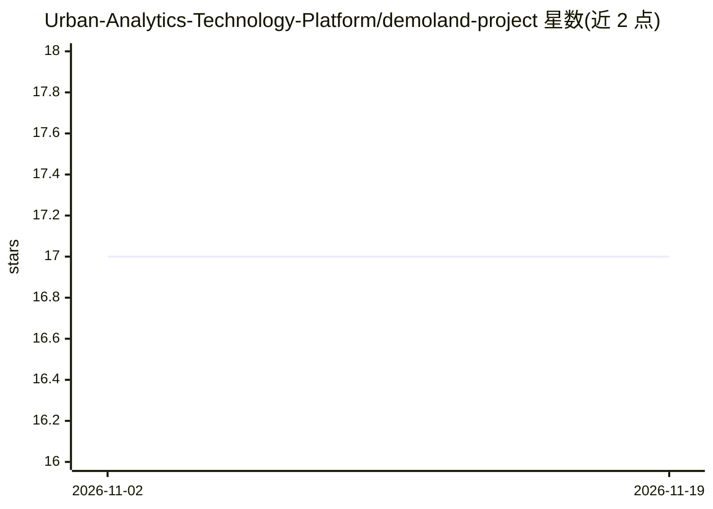

# Urban-Analytics-Technology-Platform/demoland-project

⭐ 17 · Jupyter Notebook · MIT · 推送 2026-11-02 · [GitHub](https://github.com/Urban-Analytics-Technology-Platform/demoland-project) · [官网](https://urban-analytics-technology-platform.github.io/demoland-project/) · 组织维护

**英国城市用地特征量化建模系统：研究代码+Web 应用+方法书**

面向英国城市环境的用地建模研究项目：以 Python 研究代码（Jupyter notebook 组织于 code 目录）量化用地特征，提供 code/environment.yml 供 conda 复现环境。另含两个交付物：一个在线 Web 应用，用于可视化模型输出并对比不同场景（代码另行托管）；一个 Quarto 编写的方法书，完整描述项目方法论，含记录项目演进史的 notes.qmd（不纳入正式输出）。本仓库本身不提供成品软件安装包。

## 筛选速览

| 维度 | 判定 | 备注 |
|---|---|---|
| AI 角色 | `ai-ecosystem` | LLM/agent 周边工具 |
| 许可风险 | `permissive` | MIT |
| 部署形态 | `None` |  |
| 模型依赖 | — | README 未给出锁定关系 |
| 硬件要求 | — | 无带数字的原话,不猜 |
| 安装摩擦 | `low` | 无编译、无系统依赖或容器化 |
| 成熟度 | — | 结构信号不足 |

## 能力要点

- Python 研究代码以 Jupyter notebook 组织，conda 环境可复现
- Web 应用支持模型输出可视化与多场景对比
- Quarto 方法书完整描述项目方法论
- notes.qmd 记录项目演进史

## 适用场景

- 复现英国城市用地建模研究
- 通过 Web 应用对比不同用地场景的模型输出
- 查阅项目完整方法论文档

## 场景标签

 · 领域:城市分析/空间建模

## 证据(README 行号)

> L1: # LandUseDemonstrator
> L3: Developing a modelling system to quantify features of land use in urban environments for the United Kingdom.
> L7: The research code is written in Python and is organised in the `code` folder in the individual Jupyter notebooks.

## 星数曲线

2026-11-02 17 → 2026-11-19 17（+0）

---
*卡片 v1 · prompt 1.4 · 生成 2026-11-18 · 置信度 low · 依据 README sha `87542a9fe1e3` · [字段定义](../../DATASET.md)*
