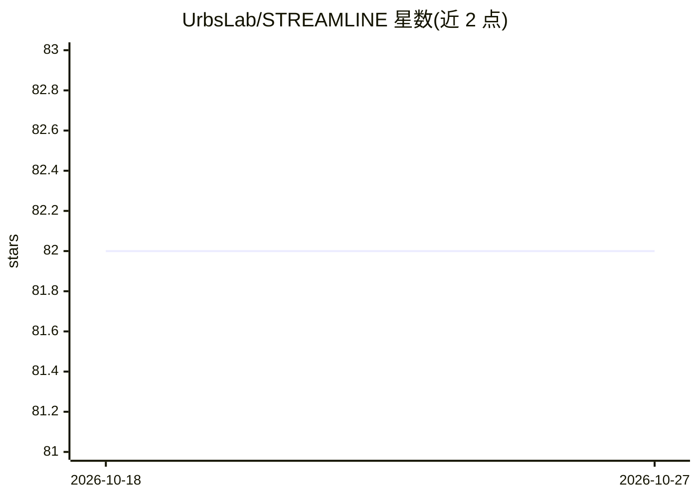

# UrbsLab/STREAMLINE

⭐ 82 · Jupyter Notebook · GPL-3.0 · 推送 2026-09-22 · [GitHub](https://github.com/UrbsLab/STREAMLINE) · [官网](https://urbslab.github.io/STREAMLINE/) · 组织维护

**结构化表格数据的端到端自动机器学习流水线**

面向监督学习的可并行、可定制端到端 AutoML 流水线，处理结构化表格数据，覆盖二分类、多分类与回归三类任务。流水线分 11 个阶段：数据处理、插补与缩放、特征学习、特征重要性、特征选择、多算法建模（含 Optuna 超参优化）、集成、汇总统计、数据集比较、外部复现与 PDF 报告。支持 Colab、本地 Jupyter、CLI 与配置文件驱动运行，可经 joblib/Dask/SLURM/LSF 并行。限制：Phase 7 集成仅支持分类；TabPFN 需 Prior Labs token。

## 筛选速览

| 维度 | 判定 | 备注 |
|---|---|---|
| AI 角色 | `ai-ecosystem` | LLM/agent 周边工具 |
| 许可风险 | `viral` | GPL-3.0 |
| 部署形态 | `library` | 以包/库形式分发 |
| 模型依赖 | — | README 未给出锁定关系 |
| 硬件要求 | — | 无带数字的原话,不猜 |
| 安装摩擦 | `low` | 无编译、无系统依赖或容器化 |
| 成熟度 | — | 结构信号不足 |

## 能力要点

- 11 阶段端到端流水线，覆盖探索分析到 PDF 报告
- 支持二分类/多分类/回归三类监督任务
- 多算法建模加 Optuna 超参优化与分类集成
- 支持 Colab/Jupyter/CLI/配置文件与 joblib/Dask/HPC 并行运行

## 适用场景

- 在表格数据上跑完整建模流程并生成可发表的评估报告
- 对比多个机器学习算法并做统计显著性比较
- 将训练好的流程应用到外部复现数据集验证稳健性

## 场景标签

`MLOps` · 领域:训练与推理

## 证据(README 行号)

> L5: STREAMLINE is a parallelizable, customizable, end-to-end automated machine learning pipeline for supervised learning
> L7: STREAMLINE is designed to make rigorous machine learning workflows easier to run, compare, reproduce, and extend. It

## 星数曲线

2026-10-18 82 → 2026-10-27 82（+0）

---
*卡片 v1 · prompt 1.4 · 生成 2026-10-24 · 置信度 mid · 依据 README sha `804ce072b414` · [字段定义](../../DATASET.md)*
