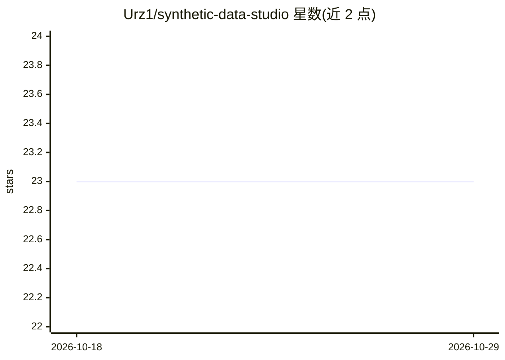

# Urz1/synthetic-data-studio

⭐ 23 · TypeScript · MIT · 推送 2026-03-30 · [GitHub](https://github.com/Urz1/synthetic-data-studio) · [官网](https://www.synthdata.studio/) · 个人维护

**面向医疗/金融等监管行业的差分隐私合成数据生成平台**

自托管的合成数据生成 Web 应用（FastAPI 后端 + Next.js 前端），支持三种生成方式：基于 Schema 定义直接生成、基于真实数据集训练 ML 模型（CTGAN/TVAE/GaussianCopula，来自 SDV）以及 LLM 生成种子数据再统计扩展。提供可配置 ε/δ 的差分隐私（Opacus + RDP 会计）、PII/PHI 自动检测、HIPAA/GDPR/SOC-2 合规报告、统计相似度与隐私风险评估及 AI 聊天助手。面向医疗（HIPAA）、金融（SOC-2/GDPR）与 ML 团队，运行需 PostgreSQL、Redis 等依赖，通过 git clone 源码部署。

## 筛选速览

| 维度 | 判定 | 备注 |
|---|---|---|
| AI 角色 | `ai-ecosystem` | LLM/agent 周边工具 |
| 许可风险 | `permissive` | MIT |
| 部署形态 | `None` |  |
| 模型依赖 | — | README 未给出锁定关系 |
| 硬件要求 | — | 无带数字的原话,不猜 |
| 安装摩擦 | `low` | 无编译、无系统依赖或容器化 |
| 成熟度 | — | 结构信号不足 |

## 能力要点

- 三种生成方式：Schema 定义、数据集训练 ML 模型、LLM 种子数据扩展
- 差分隐私 ε/δ 可配置，含 RDP 会计与隐私预算跟踪
- PII/PHI 自动检测与 HIPAA/GDPR/SOC-2 合规报告生成
- 质量评估：统计相似度、ML 效用保持、成员推断与 k-匿名性检查

## 适用场景

- 医疗/金融企业生成隐私安全的合成 EHR 或交易数据
- ML 团队用合成数据替代真实敏感数据训练模型
- 生成监管合规所需的合成数据与配套文档

## 场景标签

 · 领域:数据隐私/合成数据

## 证据(README 行号)

> L26: Generate high-quality synthetic data with **differential privacy** guarantees. Built for regulated industries:
> L42: |**Dataset-Based ML**|Train on real data → generate synthetic|Production quality|
> L182: - **ML/Privacy:** CTGAN, TVAE, Opacus (DP), RDP accounting

## 星数曲线

2026-10-18 23 → 2026-10-29 23（+0）

---
*卡片 v1 · prompt 1.4 · 生成 2026-10-27 · 置信度 mid · 依据 README sha `d3936a966dec` · [字段定义](../../DATASET.md)*
