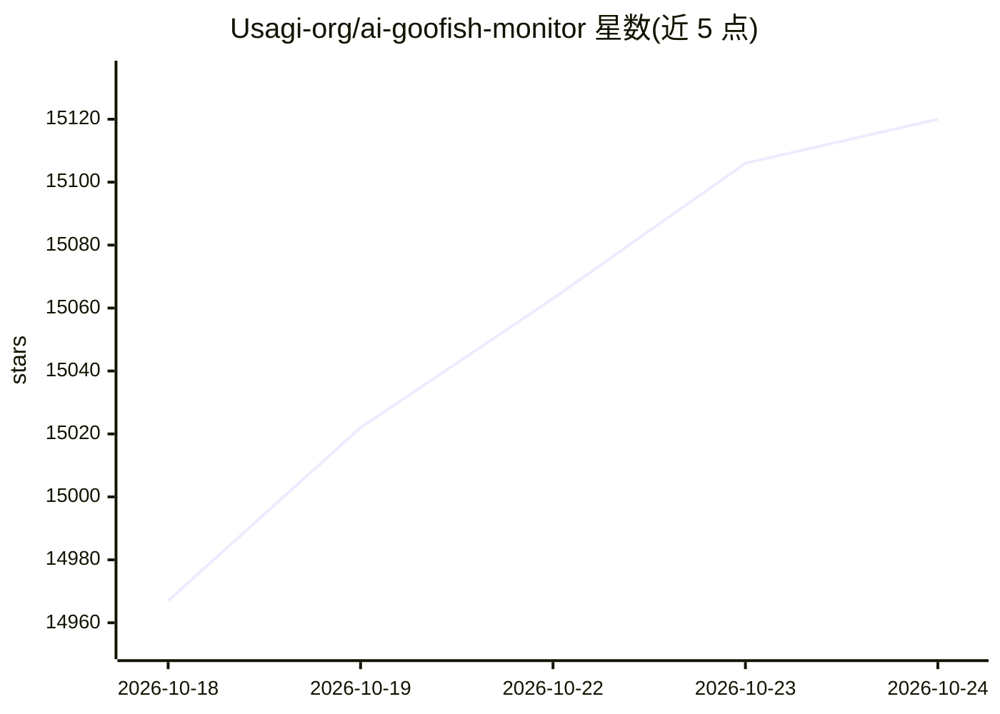

# Usagi-org/ai-goofish-monitor

⭐ 15,120 · Python · MIT · 推送 2026-10-10 · [GitHub](https://github.com/Usagi-org/ai-goofish-monitor) · 组织维护 · 中文 README

**面向闲鱼用户的商品实时监控与 AI 智能分析系统**

基于 Playwright 的闲鱼多任务监控系统，提供 Web 管理界面，覆盖任务管理、账号登录态管理、AI 标准编辑、运行日志与结果浏览。支持自然语言创建任务（后台异步生成分析标准）与关键词规则两种模式，多模态模型分析商品图片，结果持久化到 SQLite。支持 Cron 定时调度、多账号与代理池轮换、ntfy/企业微信/Bark/Telegram/Webhook 通知，Docker 一键部署。通过 Chrome 扩展导出闲鱼登录态，作者提示需遵守平台协议、避免账号被限制。

## 筛选速览

| 维度 | 判定 | 备注 |
|---|---|---|
| AI 角色 | `ai-enhanced` | 去掉 AI 部分产品仍成立 |
| 许可风险 | `permissive` | MIT |
| 部署形态 | `self-host` | docker 或自建部署 |
| 模型依赖 | — | README 未给出锁定关系 |
| 硬件要求 | — | 无带数字的原话,不猜 |
| 安装摩擦 | `low` | 无编译、无系统依赖或容器化 |
| 成熟度 | — | 结构信号不足 |

## 动量与使用信号

- 维护:`active` — 距上次 push 8.0 天,年发版 10,21 位贡献者
- 涨星:近 1 天 **+81**(自 20261016 起算)
- 安装:pypi 包 `playwright` 月下载 97,001,677
- 平台:LINUX / WEB · 协议:—

## 能力要点

- 自然语言创建监控任务，AI 模式后台 job 异步生成分析标准
- 多模态模型深度分析商品，需支持图片输入的模型
- 多账号管理与代理池轮换、失败重试与任务暂停保护
- SQLite 主存储，自动从旧 config.json/jsonl/price_history 导入历史数据

## 适用场景

- 实时或定时监控闲鱼指定关键词的新发布商品
- 按价格范围、区域等条件筛选并接收多渠道通知
- 追踪商品价格历史与监控任务运行日志

## 场景标签

`浏览器自动化` · 领域:效率与自动化

## 证据(README 行号)

> L5: 基于 Playwright 和 AI 的闲鱼多任务实时监控，提供完整的 Web 管理界面。
> L10: - **AI 驱动**: 自然语言创建任务，多模态模型深度分析商品
> L11: - **多任务并发**: 独立配置关键词、价格、筛选条件和 AI Prompt

## 星数曲线

2026-10-18 14,967 → 2026-10-24 15,120（+153）

---
*卡片 v1 · prompt 1.4 · 生成 2026-10-18 · 置信度 mid · 依据 README sha `b439ea8f69c9` · [字段定义](../../DATASET.md)*
