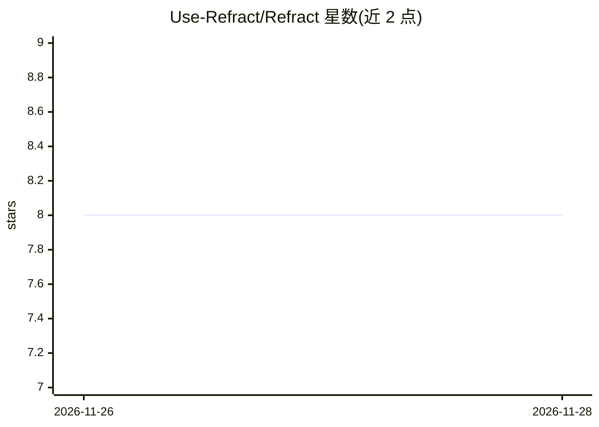

# Use-Refract/Refract

⭐ 8 · Go · MIT · 推送 2026-11-27 · [GitHub](https://github.com/Use-Refract/Refract) · 组织维护

**自托管 LaTeX 工作区：AI 以 diff 提案方式协助写作**

面向在自建服务器上写作 LaTeX 文档的用户：集成 CodeMirror 编辑器、Tectonic 编译与 SyncTeX 双向 PDF 预览，AI 助手在项目副本的 git worktree 中工作，所有改动以逐文件 diff 形式提交给用户接受或拒绝；引用检索 OpenAlex 与 arXiv，BibTeX 条目由 doi.org/arXiv 元数据生成而非模型撰写；每个项目即一个 git 仓库，版本历史完整可回滚；支持 ChatGPT 订阅、自有 API key 或本地 Ollama 模型。

## 筛选速览

| 维度 | 判定 | 备注 |
|---|---|---|
| AI 角色 | `ai-native` | 本体是模型或模型工具 |
| 许可风险 | `permissive` | MIT |
| 部署形态 | `desktop` | 安装包/桌面程序 |
| 模型依赖 | local-ok | 支持本地模型 |
| 硬件要求 | — | 无带数字的原话,不猜 |
| 安装摩擦 | `low` | 无编译、无系统依赖或容器化 |
| 成熟度 | — | 结构信号不足 |

## 能力要点

- AI 改动以 diff 提案呈现，逐文件接受或拒绝
- 引用元数据来自 OpenAlex/arXiv/doi.org，非模型生成
- 助手在独立 git worktree 运行，可同时编译和自查错误
- Tectonic 编译无需安装 TeX 发行版，错误条目附 Fix with AI

## 适用场景

- 在自己服务器上撰写论文并保留完整版本历史
- 让 AI 助手起草修改，再逐文件审查接受
- 为段落查找真实文献并生成 BibTeX 引用

## 场景标签

`科研工具` `AI 写作` · 领域:内容生成

## 证据(README 行号)

> L3: A self-hosted LaTeX workspace with an AI assistant that proposes changes you review as diffs.
> L31: - **Use the AI you already pay for.** Your ChatGPT plan, your own API keys (OpenAI, Anthropic, Gemini, OpenRouter a

## 星数曲线

2026-11-26 8 → 2026-11-28 8（+0）

---
*卡片 v1 · prompt 1.4 · 生成 2026-11-26 · 置信度 mid · 依据 README sha `f04dc94629f7` · [字段定义](../../DATASET.md)*
