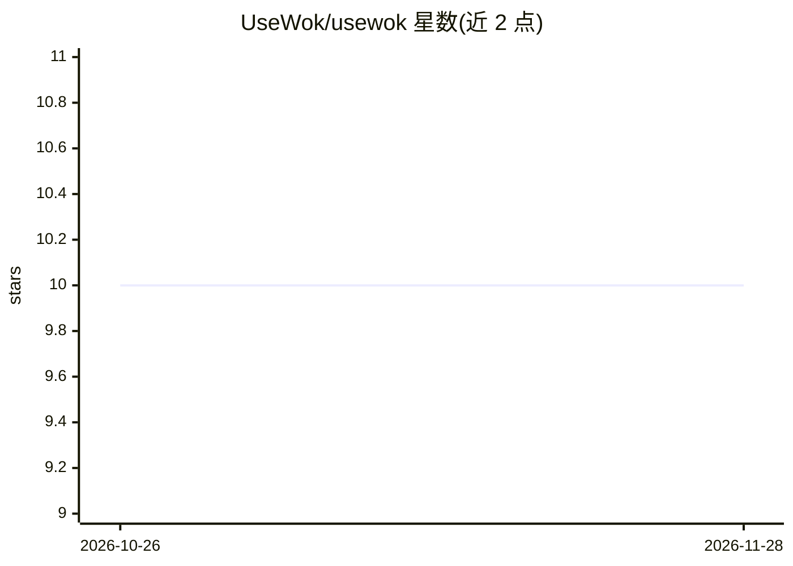

# UseWok/usewok

⭐ 10 · JavaScript · 推送 2026-08-23 · [GitHub](https://github.com/UseWok/usewok) · [官网](https://usewok.com) · 组织维护

**为 SaaS 产品代运营公开曝光与目录提交的服务**

UseWok 是一项面向 SaaS 创始人的托管服务：用户选定品牌方向与渠道后，由服务方执行来源调研、付费目录（Premium Directory）提交、原创文章撰写发布、社媒帖子准备与进度追踪。工作区仅展示进行中事项、已完成工作与公开 URL。提供一次性与订阅制三档定价（$59/$89 一次性、$69/月），并列出其目录排名等公开结果作为佐证。README 未提供源码、安装方式或本地运行说明。

## 筛选速览

| 维度 | 判定 | 备注 |
|---|---|---|
| AI 角色 | `ai-enhanced` | 去掉 AI 部分产品仍成立 |
| 许可风险 | `none` | — |
| 部署形态 | `None` |  |
| 模型依赖 | — | README 未给出锁定关系 |
| 硬件要求 | — | 无带数字的原话,不猜 |
| 安装摩擦 | `low` | 无编译、无系统依赖或容器化 |
| 成熟度 | — | 结构信号不足 |

## 能力要点

- 代执行目录提交、文章撰写与社媒发布的托管服务
- 三档定价：Starter/Growth 一次性付费，Prime 按月订阅
- 工作区展示进度、已完成工作与公开 URL
- 提供免费工具检查当前 AI 可见性

## 适用场景

- SaaS 上线后在多个目录提交产品档案
- 外包品牌内容的撰写与发布流程
- 追踪产品公开链接与曝光进度

## 场景标签

 · 领域:营销/SEO 服务

## 证据(README 行号)

> L3: Your SaaS visibility, handled.
> L7: You choose the brand direction and channels. UseWok handles the research, Premium Directory submissions, original co
> L143: Free tools: Check your current AI visibility

## 星数曲线

2026-10-26 10 → 2026-11-28 10（+0）

---
*卡片 v1 · prompt 1.4 · 生成 2026-11-20 · 置信度 low · 依据 README sha `ef8b0e17c326` · [字段定义](../../DATASET.md)*
