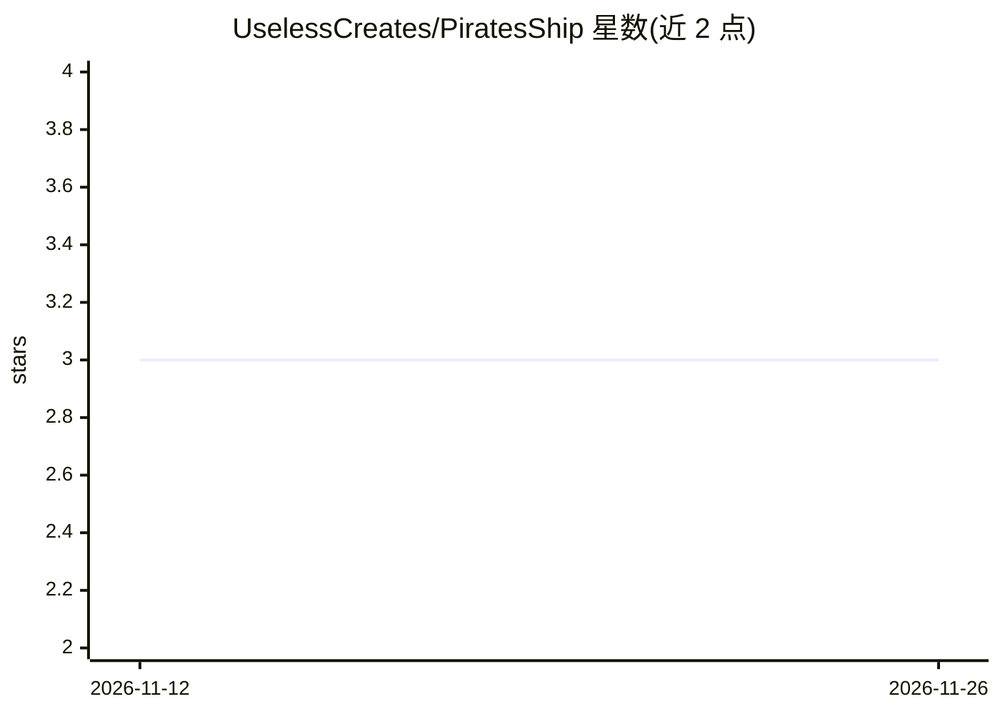

# UselessCreates/PiratesShip

⭐ 3 · HTML · 推送 2026-11-04 · [GitHub](https://github.com/UselessCreates/PiratesShip) · [官网](https://discord.gg/WMqJhE8a2v) · 个人维护

**让用户基于证据重建网站/应用/游戏的 Windows 桌面 AI 构建工具**

PiratesShip 是一个 Windows 桌面应用（Rust 原生窗口 + Node 引擎），按侦察—规划—构建—验证四段流水线重建参考目标：通过截图服务与代理获取真实 HTML/CSS、多尺寸截图与配色字体统计，写入 _recon/ 目录，再由所选模型生成重建计划与静态站点文件，验证失败时执行一次自动修复，并输出保真度审计。支持 42 个模型预设（33 家云服务商、8 个免费/本地选项、任意 OpenAI 兼容端点），提供无模型的 Free mode（零 API 调用、确定性生成）。原生外壳仅支持 Windows，引擎与 UI 可在任意 Node 环境运行。

## 筛选速览

| 维度 | 判定 | 备注 |
|---|---|---|
| AI 角色 | `ai-native` | 本体是模型或模型工具 |
| 许可风险 | `none` | — |
| 部署形态 | `desktop` | 安装包/桌面程序 |
| 模型依赖 | local-ok | 支持本地模型 |
| 硬件要求 | — | 无带数字的原话,不猜 |
| 安装摩擦 | `low` | 无编译、无系统依赖或容器化 |
| 成熟度 | `idea` | |

## 能力要点

- 侦察—规划—构建—验证四段重建流水线，证据存盘为 _recon/ 目录
- 42 个模型预设：33 家云服务商 + 8 个免费/本地选项 + 自定义端点
- Free mode 无需任何模型与 API key，从证据确定性生成响应式站点
- 验证失败自动修复一次，并用保真度审计量化证据利用率

## 适用场景

- 输入一个网站 URL，重建其结构、配色与响应式规则
- 以真实截图与 HTML 证据为依据复刻页面而不是凭猜测
- 在本地模型或无模型模式下离线生成静态站点

## 场景标签

`代码生成` · 领域:编码与开发

## 证据(README 行号)

> L17: PiratesShip is a Windows desktop app: **Rust owns the window, Node owns the work.**
> L127: PiratesShip includes **42 model presets**.
> L180: ### The reconstruction pipeline

## 星数曲线

2026-11-12 3 → 2026-11-26 3（+0）

---
*卡片 v1 · prompt 1.4 · 生成 2026-11-22 · 置信度 mid · 依据 README sha `8d5066767e23` · [字段定义](../../DATASET.md)*
