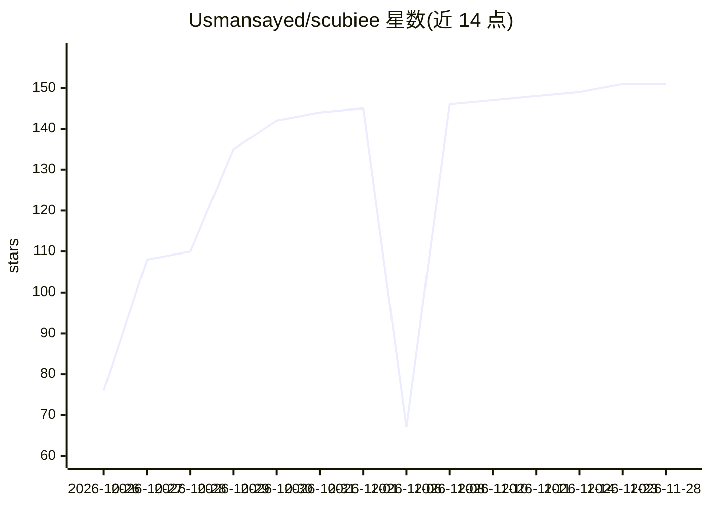

# Usmansayed/scubiee

⭐ 151 · Python · Apache-2.0 · 推送 2026-10-25 · [GitHub](https://github.com/Usmansayed/scubiee) · [官网](https://scubiee.com) · 个人维护

**给 AI 编码 agent 提供本地代码语义检索的上下文引擎**

在本地为代码仓库建立可检索索引的 MCP 服务器：通过 Tree-sitter 解析、代码图（调用/导入/定义）、BM25 与 FAISS 稠密嵌入三路融合检索，向 Cursor、Claude Code、Copilot 等 MCP 客户端提供 `map find`（定位）与 `focus`（符号体+调用关系）工具，并以后台 daemon 基于 Merkle 树增量同步保持索引新鲜。解析、嵌入、检索均在本地运行，代码不上传；仅首次下载约 270 MB 嵌入模型。需 Python 3.11+，用 `init` 与 `connect` 两步接入。README 声明基准为单一代码库的内部测试。

## 筛选速览

| 维度 | 判定 | 备注 |
|---|---|---|
| AI 角色 | `ai-ecosystem` | LLM/agent 周边工具 |
| 许可风险 | `permissive` | Apache-2.0 |
| 部署形态 | `library` | 以包/库形式分发 |
| 模型依赖 | — | README 未给出锁定关系 |
| 硬件要求 | — | 无带数字的原话,不猜 |
| 安装摩擦 | `medium` | 含编译或系统依赖之一 |
| 成熟度 | — | 结构信号不足 |

## 能力要点

- 以 MCP 服务器形式接入 Cursor、Claude Code、Copilot、Kiro 等 14 个客户端（一键 connect）
- 代码图 + BM25 + FAISS 稠密嵌入的三路融合检索，单工具 `map` 含 find/focus 两配置
- 本地 daemon 基于 Merkle 树增量同步，只重建变更部分
- 支持 CUDA / DirectML / Apple MLX / CPU 加速自动选择

## 适用场景

- 减少编码 agent 在大仓库中盲目 grep 的 token 消耗
- 让 AI 助手按含义定位代码并获取符号调用关系
- 在代码不出本机的约束下为 agent 提供语义搜索

## 场景标签

`语义搜索` · 领域:知识与检索

## 证据(README 行号)

> L11:  A local code-context engine for AI coding agents.
> L27: - **Built for agents.** Ships as an MCP server and works in
> L40: - **Fused retrieval** over a code graph (calls / imports / definitions), BM25 lexical match, and

## 星数曲线

2026-10-26 76 → 2026-11-28 151（+75）

---
*卡片 v1 · prompt 1.4 · 生成 2026-11-27 · 置信度 high · 依据 README sha `b993bc0858a4` · [字段定义](../../DATASET.md)*
