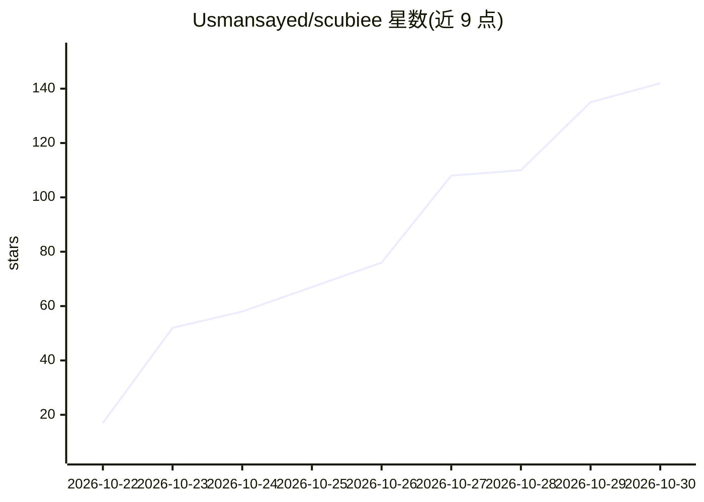

# Usmansayed/scubiee

⭐ 142 · Python · Apache-2.0 · 推送 2026-10-25 · [GitHub](https://github.com/Usmansayed/scubiee) · [官网](https://scubiee.com) · 个人维护

**本地代码上下文引擎：为 AI 编程代理提供语义化代码检索**

面向 Cursor、Claude Code、Copilot 等 MCP 客户端的本地代码上下文引擎：用 Tree-sitter 解析仓库并在本地生成磁盘嵌入，通过 MCP 服务提供一个 map 工具（find 排名定位、focus 符号聚焦），检索融合代码调用图、BM25 词法匹配与稠密嵌入（CodeRankEmbed/FAISS）三路信号，后台用 Merkle diff 保持索引实时同步。代码不上传，仅一次性下载约 270MB 嵌入模型，此后可离线索引。需 Python 3.11+，通过 uv 或 pip 安装。

## 筛选速览

| 维度 | 判定 | 备注 |
|---|---|---|
| AI 角色 | `ai-ecosystem` | LLM/agent 周边工具 |
| 许可风险 | `permissive` | Apache-2.0 |
| 部署形态 | `library` | 以包/库形式分发 |
| 模型依赖 | — | README 未给出锁定关系 |
| 硬件要求 | — | 无带数字的原话,不猜 |
| 安装摩擦 | `low` | 无编译、无系统依赖或容器化 |
| 成熟度 | — | 结构信号不足 |

## 能力要点

- MCP server 形式接入 Cursor/Claude Code/Copilot/Kiro 等客户端
- find/focus 两种 map 配置：排名定位与符号全身体+调用关系
- 代码图 + BM25 + 稠密嵌入三路融合检索
- Merkle diff 后台同步，编辑后数秒内索引更新，全程本地运行

## 适用场景

- 让 AI 编程助手按语义定位代码，减少盲目 grep 的 token 消耗
- 在本地为大型仓库构建不离开机器的代码索引
- 从终端直接用 scubiee search 检索代码，不依赖 IDE

## 场景标签

`语义搜索` · 领域:知识与检索

## 证据(README 行号)

> L25: - **Built for agents.** Ships as an MCP server — works in
> L86: A small local daemon serves retrieval over three fused channels — a code **graph**

## 星数曲线

2026-10-22 17 → 2026-10-30 142（+125）

---
*卡片 v1 · prompt 1.4 · 生成 2026-10-24 · 置信度 high · 依据 README sha `2f2bbf0c0dc6` · [字段定义](../../DATASET.md)*
