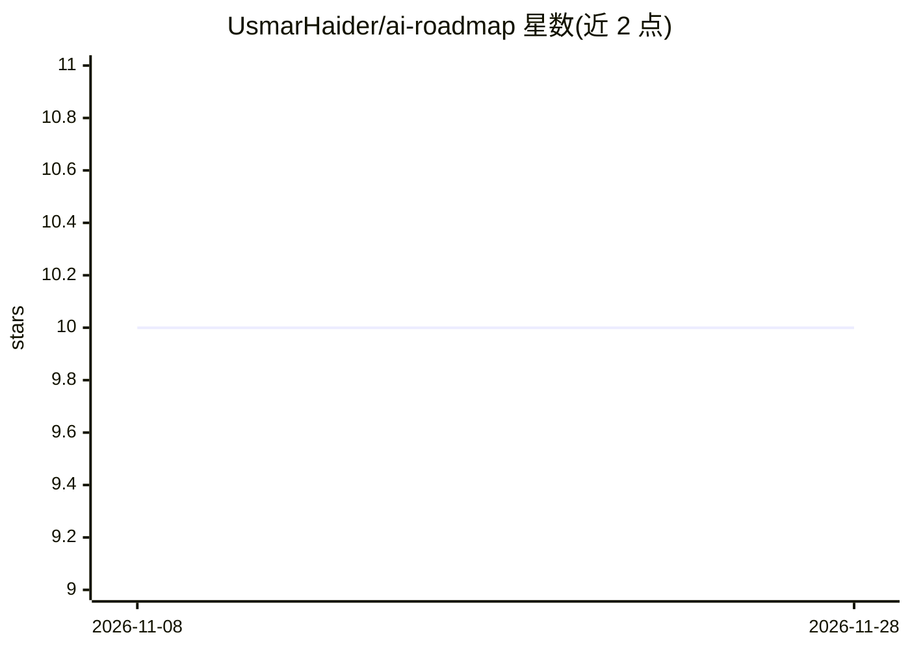

# UsmarHaider/ai-roadmap

⭐ 10 · MIT · 推送 2026-07-30 · [GitHub](https://github.com/UsmarHaider/ai-roadmap) · 个人维护

**从零到专家的 AI 学习路线图：免费课程与实战项目清单**

一份纯资源聚合型学习路线文档，按 Level 0（Python/数学）到 LLM 专家分阶段组织，每级提供课程、视频、文章与 Kaggle/GitHub 实战项目链接，并附自检清单（checkpoint）作为阶段门槛。预估总时长 9-14 个月（每周 10-15 小时）。内容以表格形式罗列外部资源，不含任何可安装的软件本体。

## 筛选速览

| 维度 | 判定 | 备注 |
|---|---|---|
| AI 角色 | `ai-knowledge` | 知识聚合/清单类 |
| 许可风险 | `permissive` | MIT |
| 部署形态 | `None` |  |
| 模型依赖 | — | README 未给出锁定关系 |
| 硬件要求 | — | 无带数字的原话,不猜 |
| 安装摩擦 | `low` | 无编译、无系统依赖或容器化 |
| 成熟度 | — | 结构信号不足 |

## 能力要点

- 按难度分级的完整 AI 学习路径，含各阶段时长估计
- 每级附 Kaggle/GitHub 实战项目与学习他人代码的建议
- 每级设置可勾选的 checkpoint 自检清单
- 全部资源声明为免费

## 适用场景

- 规划从编程基础到深度学习的系统学习路径
- 寻找各阶段免费的课程、视频与书籍资源
- 通过 Kaggle 项目练手并检验阶段学习成果

## 场景标签

`教程课程` · 领域:学习与行业

## 证据(README 行号)

> L3: > A step-by-step, **100% free** roadmap to go from absolute beginner to AI expert.
> L4: > Every level has: 🎓 courses · 📺 videos · 📄 articles · 🛠️ real projects (Kaggle & GitHub) · ✅ a checkpoint before yo

## 星数曲线

2026-11-08 10 → 2026-11-28 10（+0）

---
*卡片 v1 · prompt 1.4 · 生成 2026-11-20 · 置信度 high · 依据 README sha `b2307950bc0f` · [字段定义](../../DATASET.md)*
