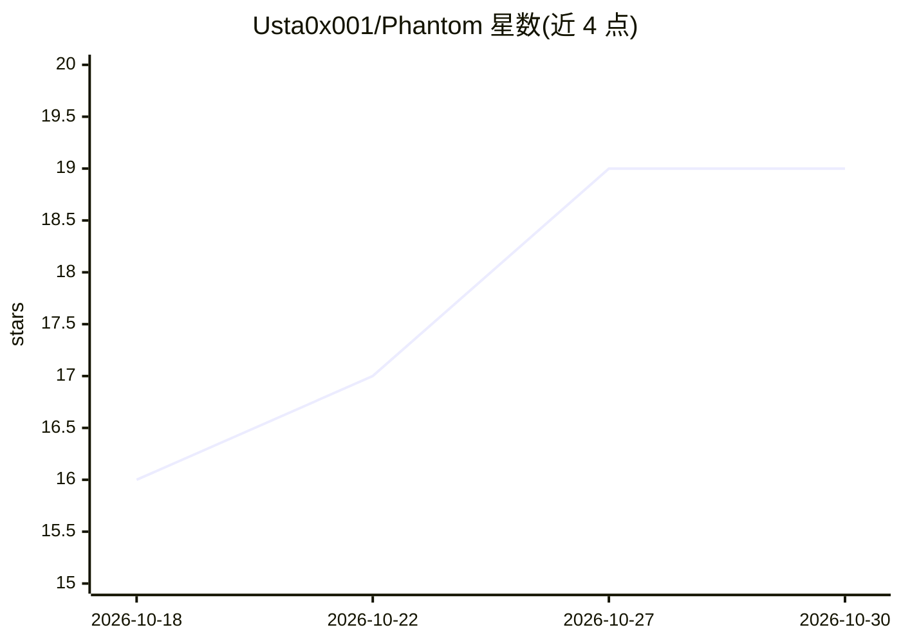

# Usta0x001/Phantom

⭐ 19 · Python · 推送 2026-05-10 · [GitHub](https://github.com/Usta0x001/Phantom) · 个人维护

**给安全测试者的自主 AI 渗透测试代理，输出经验证的漏洞报告**

基于 ReAct 循环的自主渗透测试代理：LLM 编排 53 个安全工具（nmap、nuclei、sqlmap 等），在隔离的 Kali Linux Docker 沙箱中执行侦察、利用与验证，每个发现附原始 HTTP 证据、复现步骤与 PoC 脚本，并自动做 MITRE ATT&CK/CWE 标注与 OWASP/PCI DSS/NIST 合规映射。通过 LiteLLM 支持 100+ LLM 提供商（含 Ollama 本地），支持并行子代理、跨扫描知识持久化与费用上限。pip 或 Docker 安装，需 Docker、Python 3.12+ 与 LLM API key；仅限测试已授权系统。

## 筛选速览

| 维度 | 判定 | 备注 |
|---|---|---|
| AI 角色 | `ai-native` | 本体是模型或模型工具 |
| 许可风险 | `none` | — |
| 部署形态 | `self-host` | docker 或自建部署 |
| 模型依赖 | local-ok | 支持本地模型 |
| 硬件要求 | — | 无带数字的原话,不猜 |
| 安装摩擦 | `low` | 无编译、无系统依赖或容器化 |
| 成熟度 | — | 结构信号不足 |

## 能力要点

- ReAct 循环自主编排 53 个安全工具，多阶段侦察→利用→验证
- 所有攻击操作在一次性 Kali Docker 沙箱内运行，扫描后销毁容器
- 每个漏洞附 PoC 脚本、原始 HTTP 证据与 MITRE ATT&CK/合规映射
- LiteLLM 接入 100+ LLM 提供商，含 Ollama 本地模式；支持按扫描/按请求费用上限

## 适用场景

- 对自有系统跑自动化渗透测试并生成合规报告
- 在 CI/CD 流水线中用 quick 模式做安全门禁扫描
- 对 REST/GraphQL API 执行专注的安全扫描

## 场景标签

`网络安全` · 领域:学习与行业

## 证据(README 行号)

> L19: Phantom is an **autonomous AI penetration testing agent** built on the ReAct (Reason–Act) loop. It connects a large
> L21: Unlike CVE-signature scanners, Phantom **reasons** about your target: it reads HTTP responses, forms hypotheses, se

## 星数曲线

2026-10-18 16 → 2026-10-30 19（+3）

---
*卡片 v1 · prompt 1.4 · 生成 2026-10-28 · 置信度 high · 依据 README sha `5cab0880987d` · [字段定义](../../DATASET.md)*
