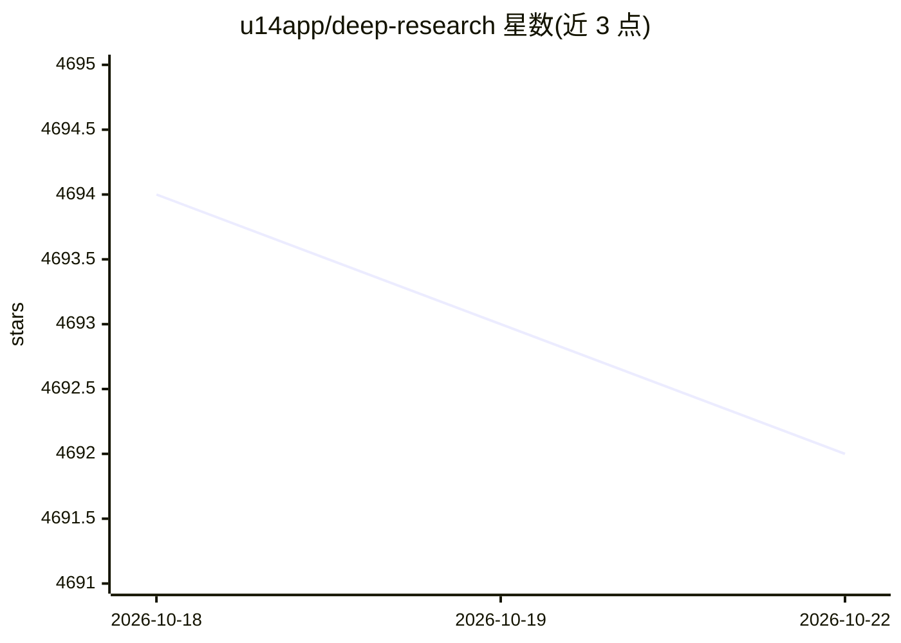

# u14app/deep-research

⭐ 4,693 · JavaScript · MIT · 推送 2026-06-18 · [GitHub](https://github.com/u14app/deep-research) · [官网](https://research.u14.app) · 个人维护 · 中文 README

**多模型深度研究工具：数分钟生成带引用的研究报告**

基于 Next.js 15 的 Web 应用，接入 Gemini、OpenAI、Anthropic、DeepSeek、Ollama、OpenRouter 等多种 LLM，结合 SearXNG、Tavily、Brave 等搜索引擎，按“思考模型+任务模型”分工执行：生成研究计划、SERP 查询、多轮信息收集，最终汇总为 Markdown 报告。支持本地知识库、知识图谱、研究历史与编辑。研究数据默认存储在本地浏览器。提供 SSE API 与 MCP server，可部署到 Vercel/Cloudflare/Docker 或作为静态页面。限制：Docker 版本可能落后最新版 1-2 天；本地模式调用 Ollama/SearXNG 需处理 CORS。

## 筛选速览

| 维度 | 判定 | 备注 |
|---|---|---|
| AI 角色 | `ai-native` | 本体是模型或模型工具 |
| 许可风险 | `permissive` | MIT |
| 部署形态 | `self-host` | docker 或自建部署 |
| 模型依赖 | local-ok | 支持本地模型 |
| 硬件要求 | — | 无带数字的原话,不猜 |
| 安装摩擦 | `low` | 无编译、无系统依赖或容器化 |
| 成熟度 | — | 结构信号不足 |

## 能力要点

- 支持十余种 LLM 提供方及任意 OpenAI 兼容接口
- 思考模型+任务模型分工，约 2 分钟生成研究报告
- 提供 SSE API 与 MCP server（StreamableHTTP/SSE 传输）
- 支持本地知识库上传、知识图谱生成与研究历史保存

## 适用场景

- 输入一个主题，让 AI 自动联网检索并生成结构化研究报告
- 把项目作为 SaaS 服务，通过 SSE API 或 MCP 接入其他 AI 应用
- 上传 PDF/Office 文件作为本地知识库做定向研究

## 场景标签

`科研工具` `文档问答` · 领域:知识与检索

## 证据(README 行号)

> L22: Deep Research uses a variety of powerful AI models to generate in-depth research reports in just a few minutes. It 
> L30: - **Support for Multi-LLM:** Supports a variety of mainstream large language models, including Gemini, OpenAI, Anth
> L39: - **Support for SaaS and MCP:** You can use this project as a deep research service (SaaS) through the SSE API, or 

## 星数曲线

2026-10-18 4,694 → 2026-10-22 4,692（-2）

---
*卡片 v1 · prompt 1.4 · 生成 2026-10-20 · 置信度 mid · 依据 README sha `bfcd8fc33a09` · [字段定义](../../DATASET.md)*
