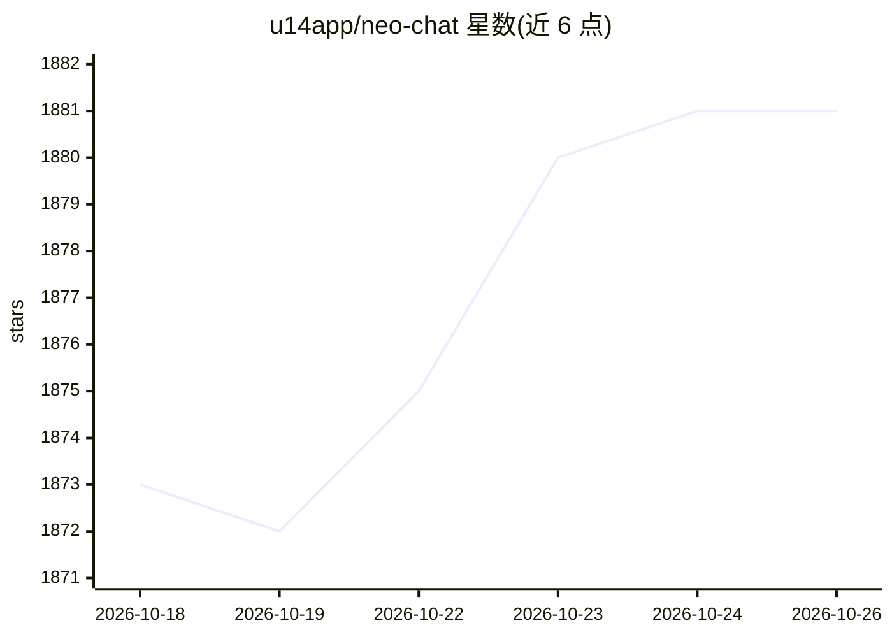

# u14app/neo-chat

⭐ 1,881 · TypeScript · MIT · 推送 2026-10-21 · [GitHub](https://github.com/u14app/neo-chat) · [官网](https://neo.u14.app) · 个人维护 · 中文 README

**本地优先的自托管 AI 聊天工作台，聚合模型、Agent 与研究**

面向终端用户的多模型聊天应用：接入 Google、OpenAI、Anthropic 及 OpenAI 兼容端点，提供 Agent 模式（多步工具工作流）、Deep Research（可审阅计划、带引用报告）、知识库检索/RAG、语音、记忆与可编辑 artifacts。扩展机制含 Text Skills、OpenAPI 插件、远程 MCP 服务器与可选 Docker 本地 MCP 桥。数据默认存浏览器本地，支持 ZIP 备份与 WebDAV/S3 端到端加密同步。需 Node.js 24 从源码运行，或用官方 Docker 镜像部署。

## 筛选速览

| 维度 | 判定 | 备注 |
|---|---|---|
| AI 角色 | `ai-native` | 本体是模型或模型工具 |
| 许可风险 | `permissive` | MIT |
| 部署形态 | `self-host` | docker 或自建部署 |
| 模型依赖 | — | README 未给出锁定关系 |
| 硬件要求 | — | 无带数字的原话,不猜 |
| 安装摩擦 | `low` | 无编译、无系统依赖或容器化 |
| 成熟度 | — | 结构信号不足 |

## 能力要点

- 接入 Google/OpenAI/Anthropic/OpenAI 兼容端点，支持图像输入与生成
- Agent 模式多步工具工作流与 Deep Research（可审阅计划、带引用报告）
- Text Skills、OpenAPI 插件、远程 MCP 服务器扩展
- 浏览器本地存储、ZIP 备份、WebDAV/S3 端到端加密同步

## 适用场景

- 自托管一个多模型聊天工作台，自带 API key 使用
- 对自有文件做知识库检索问答与深度研究报告
- 通过 MCP 插件与 Skills 扩展个人 AI 工作流

## 场景标签

`聊天机器人` `RAG` `AI 助手` · 领域:对话与助手

## 证据(README 行号)

> L12: Neo Chat brings multi-model chat, agents, and deep research into a self-hostable workspace. Connect your own model 
> L22: - **Your choice of models.** Google, OpenAI, Anthropic, and OpenAI-compatible endpoints, with image input and gener

## 星数曲线

2026-10-18 1,873 → 2026-10-26 1,881（+8）

---
*卡片 v1 · prompt 1.4 · 生成 2026-10-21 · 置信度 mid · 依据 README sha `67ef51feb1c1` · [字段定义](../../DATASET.md)*
