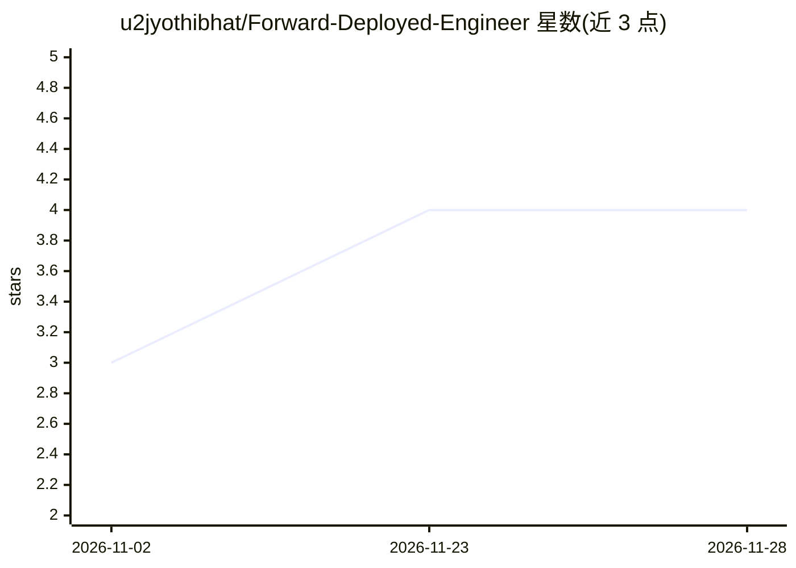

# u2jyothibhat/Forward-Deployed-Engineer

⭐ 4 · Python · MIT · 推送 2026-10-21 · [GitHub](https://github.com/u2jyothibhat/Forward-Deployed-Engineer) · 个人维护

**企业 AI 系统书籍配套实验代码，按章组织**

《Forward Deployed Engineer》一书的配套代码仓库，收录书中全部代码清单并按章节组织，对应书中的 fde-labs 项目。内容覆盖 RAG 助手（pgvector 检索与引用）、数据管道与 PII 处理、容器化与 Terraform 部署（ECS/Container Apps/Cloud Run）、CI/CD 与评估护栏、可观测性与 AIOps、Agentic AI 工具与人工审批、安全合规等实验室。读者通过 git clone 后创建 venv 运行，面向该书的读者学习使用，README 提示实验代码需按组织要求调整后才能用于生产。

## 筛选速览

| 维度 | 判定 | 备注 |
|---|---|---|
| AI 角色 | `ai-knowledge` | 知识聚合/清单类 |
| 许可风险 | `permissive` | MIT |
| 部署形态 | `self-host` | docker 或自建部署 |
| 模型依赖 | — | README 未给出锁定关系 |
| 硬件要求 | — | 无带数字的原话,不猜 |
| 安装摩擦 | `low` | 无编译、无系统依赖或容器化 |
| 成熟度 | — | 结构信号不足 |

## 能力要点

- 书中代码清单按章节组织，clone 后可直接跟随实验
- 三云（AWS/Azure/GCP）provider 中立的模型客户端
- RAG 实验含 pgvector 检索、访问控制与引用标注
- 含评估集、LLM-as-judge 评估与 GitHub Actions 质量门

## 适用场景

- 跟随书籍章节逐步搭建企业 AI 系统实验
- 学习 RAG、部署、可观测性、Agent 安全等环节的参考代码
- 复用其中的 runbook 与模板

## 场景标签

`教程课程` · 领域:学习与行业

## 证据(README 行号)

> L3: Companion code for the book **Forward Deployed Engineer: Building, deploying and operating AI systems inside the ent
> L8: Every code listing printed in the book is in this repository, organised chapter by chapter. The layout matches the `

## 星数曲线

2026-11-02 3 → 2026-11-28 4（+1）

---
*卡片 v1 · prompt 1.4 · 生成 2026-11-21 · 置信度 mid · 依据 README sha `d7f82279ed12` · [字段定义](../../DATASET.md)*
