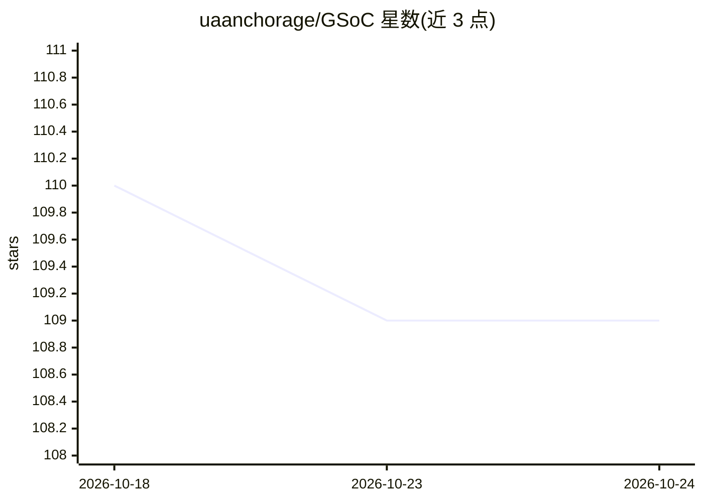

# uaanchorage/GSoC

⭐ 110 · Apache-2.0 · 推送 2026-09-07 · [GitHub](https://github.com/uaanchorage/GSoC) · [官网](https://www.uaa.alaska.edu/research) · 组织维护

**阿拉斯加大学团队的 GSoC 2027 项目创意清单（4 个课题）**

由阿拉斯加大学安克雷奇分校与费尔班克斯分校研究者联合阿拉斯加开源社区维护的 Google Summer of Code 导师组织项目创意清单，2027 年为第四次参与。收录 4 个课题：基于 PlanetLabs 卫星影像与 DeepWaterMap 的海岸线自动提取、DREAMS 项目中的位置与情绪邻近性形式化、面向医疗工作流的云边资源分配框架 WATER、本地 DICOM 影像可共享相册工具。每个课题列出导师、现状、预期成果、技能要求、工作量（350 小时）与难度等级，参与者有机会与研究者在论文中署名。

## 筛选速览

| 维度 | 判定 | 备注 |
|---|---|---|
| AI 角色 | `ai-knowledge` | 知识聚合/清单类 |
| 许可风险 | `permissive` | Apache-2.0 |
| 部署形态 | `None` |  |
| 模型依赖 | — | README 未给出锁定关系 |
| 硬件要求 | — | 无带数字的原话,不猜 |
| 安装摩擦 | `low` | 无编译、无系统依赖或容器化 |
| 成熟度 | — | 结构信号不足 |

## 能力要点

- 4 个研究型课题，覆盖海岸线提取、情绪-位置分析、边缘工作流、DICOM 相册
- 每条课题含导师联系方式、源码仓库、讨论区与 350 小时工作量标注
- 贡献者可成为与阿拉斯加大学研究者合作论文的作者或共同作者
- 提供申请模板、可接受 AI 使用政策与评分标准参考

## 适用场景

- 作为学生挑选 GSoC 课题并联系导师申请
- 了解医疗信息学、极地/气候科学方向的开放研究项目
- 按技能（Python/Java、影像处理、云边计算）匹配适合的课题

## 场景标签

`精选清单` · 领域:学习与行业

## 证据(README 行号)

> L1: # Alaska: Google Summer of Code (GSoC)
> L10: # Project Ideas

## 星数曲线

2026-10-18 110 → 2026-10-24 109（-1）

---
*卡片 v1 · prompt 1.4 · 生成 2026-10-23 · 置信度 high · 依据 README sha `489618722a5e` · [字段定义](../../DATASET.md)*
