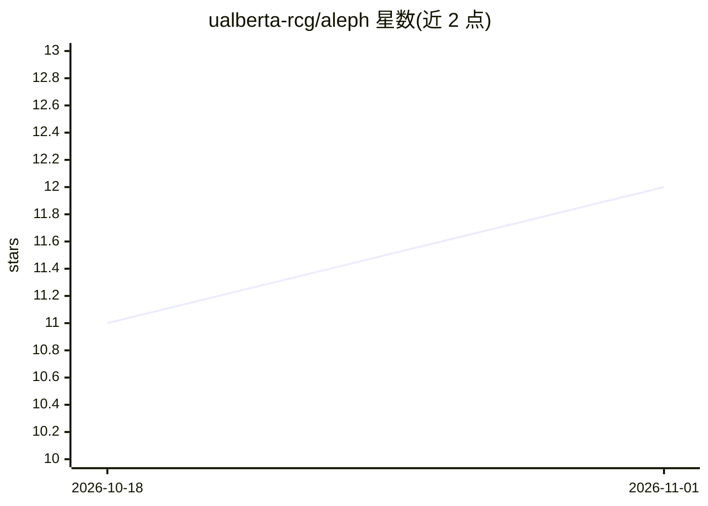

# ualberta-rcg/aleph

⭐ 12 · Python · MIT · 推送 2026-10-30 · [GitHub](https://github.com/ualberta-rcg/aleph) · [官网](https://www.ualberta.ca/en/information-services-and-technology/research-computing/index.html) · 组织维护

**科研推理集群：百余个科学与语言模型统一到一个兼容端点**

阿尔伯塔大学研究计算组维护的本地推理服务集群：在 Kubernetes（RKE2）上以 KServe/Knative 部署 100+ 科学与语言模型（蛋白质结构、基因组学、材料、气象、医学影像、LLM 等），经 Tyk 认证与 FastAPI 网关按模型名路由，提供 OpenAI/Anthropic 兼容 API 与单一 key；vLLM、TEI、NVIDIA NIM 等执行推理，HAMi 支持共享 GPU 与缩容到零。面向 agentic AI 研究者，与 HPC 协同运行仿真与推理。托管服务为概念验证、共享容量、无 SLA。

## 筛选速览

| 维度 | 判定 | 备注 |
|---|---|---|
| AI 角色 | `ai-ecosystem` | LLM/agent 周边工具 |
| 许可风险 | `permissive` | MIT |
| 部署形态 | `None` |  |
| 模型依赖 | local-ok | 支持本地模型 |
| 硬件要求 | — | 无带数字的原话,不猜 |
| 安装摩擦 | `medium` | 含编译或系统依赖之一 |
| 成熟度 | `idea` | |

## 能力要点

- 100+ 模型部署，单一端点与单一 API key 访问
- OpenAI/Anthropic 兼容 API 格式，已有工具改地址即可接入
- KServe/Knative 管理部署，vLLM/TEI/NIM/自定义容器作为运行时
- HAMi GPU 共享与缩容到零，权重持久化于 NFS

## 适用场景

- 研究流水线或 agent 免自管权重与 GPU 即可调用多种模型
- 科研团队共享常驻模型服务，避免重复部署加载
- 在自建 GPU 集群上部署多模型推理平台

## 场景标签

`推理引擎` · 领域:训练与推理

## 证据(README 行号)

> L26: Aleph is a local inference server. It serves AI models much like a web server
> L47: - **Flexible runtimes** — KServe manages deployment; vLLM, Text Embeddings
> L105: Aleph has two main layers: a gateway that accepts and routes requests, and a

## 星数曲线

2026-10-18 11 → 2026-11-01 12（+1）

---
*卡片 v1 · prompt 1.4 · 生成 2026-10-31 · 置信度 high · 依据 README sha `2c6463df0cff` · [字段定义](../../DATASET.md)*
