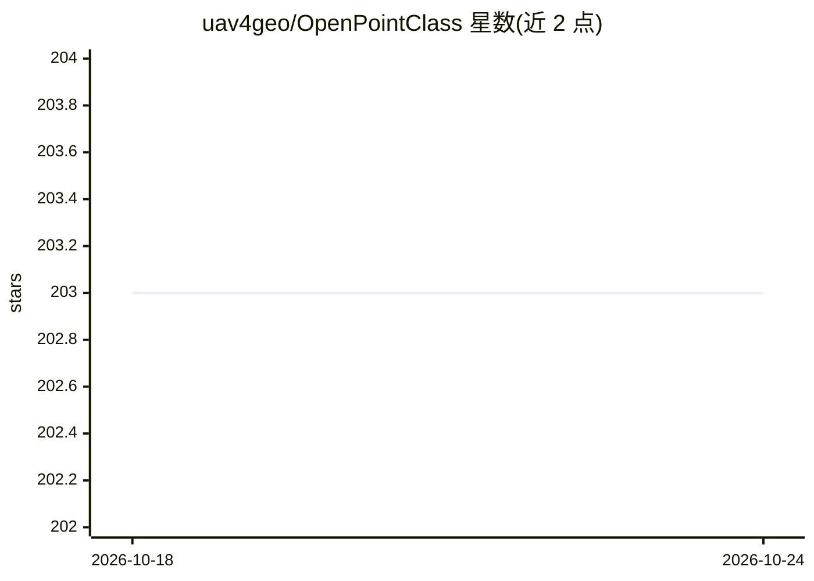

# uav4geo/OpenPointClass

⭐ 203 · C++ · AGPL-3.0 · 推送 2026-06-11 · [GitHub](https://github.com/uav4geo/OpenPointClass) · 组织维护

**三维点云语义分割工具：从标注点云训练模型并分类新数据**

开源 C++ 点云分类器，提供 pctrain 与 pcclassify 两个命令：用已标注（ASPRS 1.4 分类码）的点云训练 AI 模型（随机森林为默认，可选梯度提升树），再用模型对新点云做语义分割，默认参数下 4 核 Intel i5 约 2 分钟可分类 1500 万点。支持 PDAL 所有点云格式，不编译 PDAL 时仅支持 PLY 子集。面向摄影测量/GIS 用户，macOS/Linux 需从源码编译，Windows 可购买预编译版或自行构建，AGPLv3 许可。

## 筛选速览

| 维度 | 判定 | 备注 |
|---|---|---|
| AI 角色 | `ai-native` | 本体是模型或模型工具 |
| 许可风险 | `viral` | AGPL-3.0 |
| 部署形态 | `self-host` | docker 或自建部署 |
| 模型依赖 | — | README 未给出锁定关系 |
| 硬件要求 | — | 无带数字的原话,不猜 |
| 安装摩擦 | `low` | 无编译、无系统依赖或容器化 |
| 成熟度 | — | 结构信号不足 |

## 能力要点

- 从标注点云训练模型并分类新点云（随机森林/梯度提升树）
- 默认参数下 4 核 i5 约 2 分钟分类 1500 万点
- 支持 ASPRS 1.4 分类码及自定义重映射，覆盖 21 类地物
- 支持 PDAL 格式（LAS/LAZ），提供 Docker 镜像构建与预训练模型

## 适用场景

- 对激光雷达/摄影测量点云做地面、植被、建筑等地物自动分类
- 用自有标注数据训练专属点云分类模型并评估精度
- 输出彩色分类点云用于可视化检查

## 场景标签

`目标检测` `图像视频处理` · 领域:感知与多模态

## 证据(README 行号)

> L3: A fast, memory efficient free and open source point cloud classifier. It generates an AI model from a set of input p
> L9: On the default parameters it can classify 15 million points in less than 2 minutes on a 4-core Intel i5, which is fa

## 星数曲线

2026-10-18 203 → 2026-10-24 203（+0）

---
*卡片 v1 · prompt 1.4 · 生成 2026-10-22 · 置信度 high · 依据 README sha `253f0767c1b2` · [字段定义](../../DATASET.md)*
