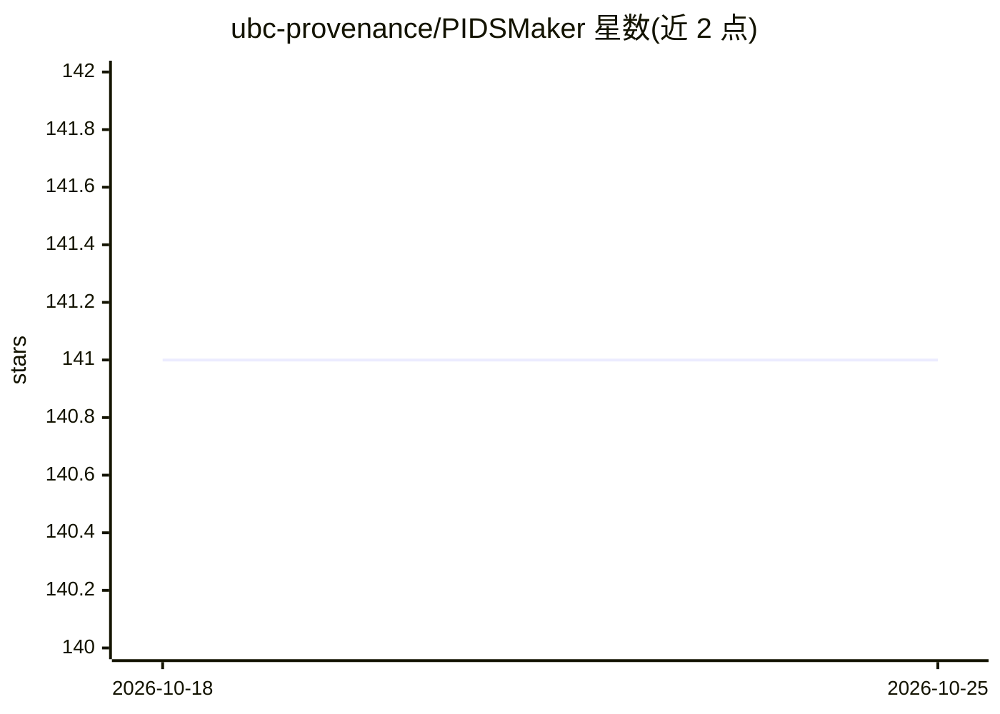

# ubc-provenance/PIDSMaker

⭐ 141 · Python · Apache-2.0 · 推送 2026-10-09 · [GitHub](https://github.com/ubc-provenance/PIDSMaker) · [官网](https://ubc-provenance.github.io/PIDSMaker/) · 组织维护

**构建溯源入侵检测系统（PIDS）的深度学习实验框架**

面向基于溯源数据的入侵检测系统（PIDS）研究者的构建与实验框架：单一代码库集成 9 个近年系统（Velox、Orthrus、Kairos 等），提供 15 个含攻击标注的溯源数据集（DARPA TC、OpTC 等）的便捷安装。支持通过 CLI 参数或 YAML 配置定制已有系统（替换编码器、层数、损失目标等）以开发新变体，集成多种预训练节点编码器（GNN 自监督、语言模型微调），并提供超参调优、W&B 实验监控与交互式 3D 节点嵌入可视化。README 声明 PIDS 训练存在不稳定性，复现结果存在挑战，需多次运行或调参。

## 筛选速览

| 维度 | 判定 | 备注 |
|---|---|---|
| AI 角色 | `ai-native` | 本体是模型或模型工具 |
| 许可风险 | `permissive` | Apache-2.0 |
| 部署形态 | `None` |  |
| 模型依赖 | — | README 未给出锁定关系 |
| 硬件要求 | — | 无带数字的原话,不猜 |
| 安装摩擦 | `low` | 无编译、无系统依赖或容器化 |
| 成熟度 | — | 结构信号不足 |

## 能力要点

- 单一代码库集成 9 个 PIDS 系统（USENIX Sec/S&P/NDSS 等会议）
- 内置 15 个带攻击标注的溯源数据集（DARPA TC、OpTC）
- 通过 CLI 覆盖参数或继承式 YAML 配置定制与新建 PIDS
- 支持超参网格调优、W&B 监控与 3D 节点嵌入交互可视化

## 适用场景

- 在同一框架下复现和对比多个溯源入侵检测系统
- 基于已有 PIDS 修改编码器或目标函数开发新变体
- 用公开溯源数据集进行 APT 检测实验与超参调优

## 场景标签

`网络安全` · 领域:学习与行业

## 证据(README 行号)

> L19: The first framework designed to build and experiment with provenance-based intrusion detection systems (PIDSs) usin
> L20: It provides a single codebase to run most recent state-of-the-arts systems and easily customize them to develop new

## 星数曲线

2026-10-18 141 → 2026-10-25 141（+0）

---
*卡片 v1 · prompt 1.4 · 生成 2026-10-22 · 置信度 high · 依据 README sha `d833b9c3ec25` · [字段定义](../../DATASET.md)*
