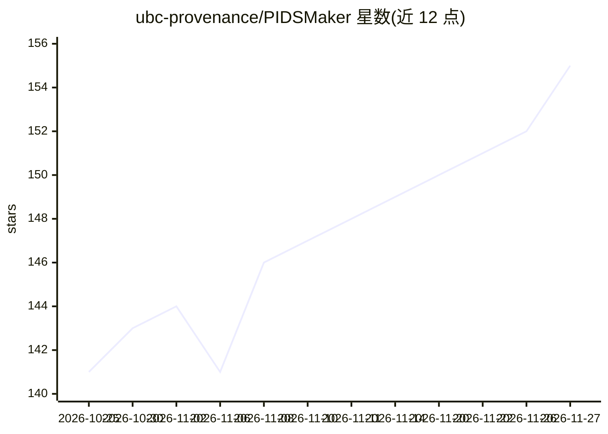

# ubc-provenance/PIDSMaker

⭐ 155 · Python · Apache-2.0 · 推送 2026-11-26 · [GitHub](https://github.com/ubc-provenance/PIDSMaker) · [官网](https://ubc-provenance.github.io/PIDSMaker/) · 组织维护

**用神经网络构建主机溯源与网络入侵检测系统的框架**

PIDSMaker 提供单一代码库与七阶段流水线，可在 17 个数据集上运行 17 个基于深度学习的入侵检测系统（PIDS/NIDS），并通过 YAML 配置继承、CLI 参数与超参搜索定制出新变体；数据集从 Hugging Face 自动下载并以 DuckDB 就地读取，支持 W&B 监控与可复现设置。面向安全与机器学习研究者，配套文档、两篇论文与 NDSS 教程；README 提醒各系统对训练扰动敏感，评估前需调参。

## 筛选速览

| 维度 | 判定 | 备注 |
|---|---|---|
| AI 角色 | `ai-native` | 本体是模型或模型工具 |
| 许可风险 | `permissive` | Apache-2.0 |
| 部署形态 | `library` | 以包/库形式分发 |
| 模型依赖 | — | README 未给出锁定关系 |
| 硬件要求 | — | 无带数字的原话,不猜 |
| 安装摩擦 | `low` | 无编译、无系统依赖或容器化 |
| 成熟度 | — | 结构信号不足 |

## 能力要点

- 单一代码库运行 17 个 SOTA 检测系统与 17 个数据集
- YAML 配置继承 + CLI 参数定制新系统
- 内置超参搜索与 W&B 实验监控
- 交互式 3D 节点嵌入查看器

## 适用场景

- 复现论文中的溯源/网络入侵检测系统实验结果
- 在现有系统上修改组件快速构造新检测变体
- 为检测模型做超参数网格搜索与调优
- 可视化探索训练产出的节点嵌入空间

## 场景标签

`网络安全` `模型评测` · 领域:评测与运维

## 证据(README 行号)

> L25: The first framework to build and experiment with deep learning intrusion detection systems, on **host provenance** 
> L26: A single codebase and pipeline runs 17 state-of-the-art systems on 17 datasets of both families, and makes them eas

## 星数曲线

2026-10-25 141 → 2026-11-27 155（+14）

---
*卡片 v1 · prompt 1.4 · 生成 2026-11-27 · 置信度 high · 依据 README sha `3685085f1de7` · [字段定义](../../DATASET.md)*
