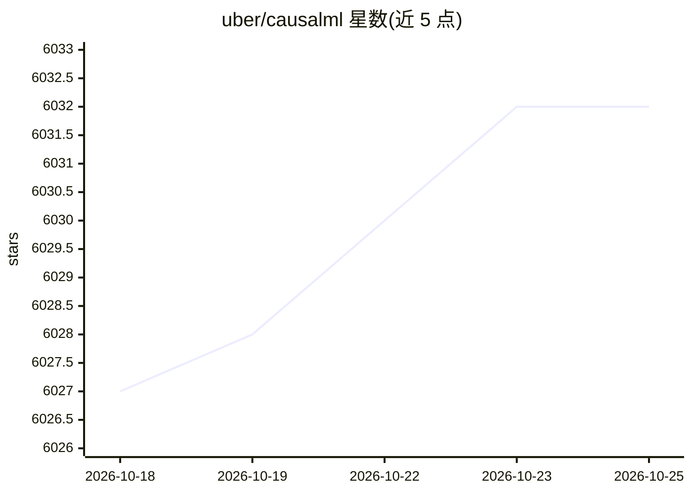

# uber/causalml

⭐ 6,032 · Python · NOASSERTION · 推送 2026-10-12 · [GitHub](https://github.com/uber/causalml) · 组织维护

**面向数据科学家的因果推断与增益建模 Python 库**

CausalML 是 Uber 维护的 Python 包，基于近年研究提供一整套增益建模（uplift modeling）与因果推断方法，通过统一接口从实验或观测数据估计条件平均处理效应（CATE），无需对模型形式做强假设。典型用途包括广告投放目标优化与个性化推荐。内置 LaLonde、IHDP、Twins 等 SHA256 校验的基准数据集加载器及 PEHE 等评估指标，附带 leaderboard notebook。项目声明处于长期支持孵化阶段，实验性代码 API 可能变化；安装文档与快速上手见 readthedocs。

## 筛选速览

| 维度 | 判定 | 备注 |
|---|---|---|
| AI 角色 | `ai-native` | 本体是模型或模型工具 |
| 许可风险 | `none` | NOASSERTION |
| 部署形态 | `library` | 以包/库形式分发 |
| 模型依赖 | — | README 未给出锁定关系 |
| 硬件要求 | — | 无带数字的原话,不猜 |
| 安装摩擦 | `low` | 无编译、无系统依赖或容器化 |
| 成熟度 | — | 结构信号不足 |

## 能力要点

- 统一接口估计 CATE，支持实验与观测数据
- 内置基准数据集加载器（LaLonde/IHDP/Twins）与 PEHE、ATE 误差、policy risk 指标
- 提供示例 notebook、估计器选择决策路径与 FAQ 文档

## 适用场景

- 从 A/B 实验或历史数据估计广告投放的个体层面因果效应
- 为不同产品和触达渠道做个性化推荐的异质处理效应估计
- 用标准基准数据集评估与比较因果推断估计器

## 场景标签

 · 领域:因果机器学习/数据科学

## 证据(README 行号)

> L12: **Causal ML** is a Python package that provides a suite of uplift modeling and causal inference methods using machi
> L13: research [[1]](#Literature). It provides a standard interface that allows user to estimate the Conditional Average 

## 星数曲线

2026-10-18 6,027 → 2026-10-25 6,032（+5）

---
*卡片 v1 · prompt 1.4 · 生成 2026-10-20 · 置信度 high · 依据 README sha `f03253e5c5b6` · [字段定义](../../DATASET.md)*
