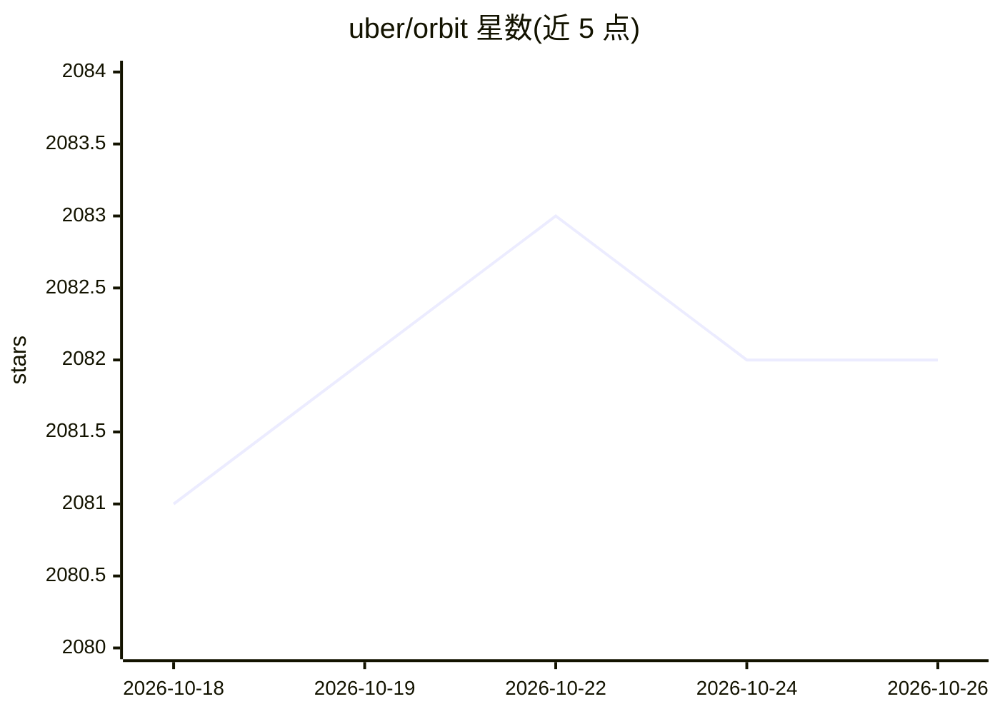

# uber/orbit

⭐ 2,082 · Python · NOASSERTION · 推送 2026-05-22 · [GitHub](https://github.com/uber/orbit) · [官网](https://orbit-ml.readthedocs.io/en/stable/) · 组织维护

**贝叶斯时间序列预测 Python 库：概率模型输出预测与推断**

Uber 维护的 Python 时间序列预测与推断库，提供 initialize-fit-predict 接口，底层使用概率编程语言（核心依赖 cmdstanpy 进行贝叶斯采样）。实现 ETS、LGT、DLT、KTR 四类模型，支持 MCMC 全采样、MAP 点估计与变分推断三种估计方法。项目自述处于长期支持孵化阶段，API 可能变动。可通过 pip/conda 安装，附文档、教程与 notebook 示例。

## 筛选速览

| 维度 | 判定 | 备注 |
|---|---|---|
| AI 角色 | `ai-native` | 本体是模型或模型工具 |
| 许可风险 | `none` | NOASSERTION |
| 部署形态 | `library` | 以包/库形式分发 |
| 模型依赖 | — | README 未给出锁定关系 |
| 硬件要求 | — | 无带数字的原话,不猜 |
| 安装摩擦 | `low` | 无编译、无系统依赖或容器化 |
| 成熟度 | `idea` | |

## 能力要点

- ETS/LGT/DLT/KTR 四类贝叶斯时间序列模型
- MCMC、MAP、变分推断三种估计方式
- initialize-fit-predict 接口，底层概率编程
- 提供 PyPI 与 conda-forge 两种安装渠道

## 适用场景

- 对业务时间序列做概率预测与区间估计
- 用 DLT/KTR 做带回归项的预测与 nowcasting
- 对预测模型在 M3 等数据上做回测

## 场景标签

 · 领域:时间序列预测/统计建模

## 证据(README 行号)

> L36: Orbit is a Python package for Bayesian time series forecasting and inference. It provides a
> L43: Currently, it supports concrete implementations for the following models:

## 星数曲线

2026-10-18 2,081 → 2026-10-26 2,082（+1）

---
*卡片 v1 · prompt 1.4 · 生成 2026-10-21 · 置信度 high · 依据 README sha `9b7da6dffa08` · [字段定义](../../DATASET.md)*
