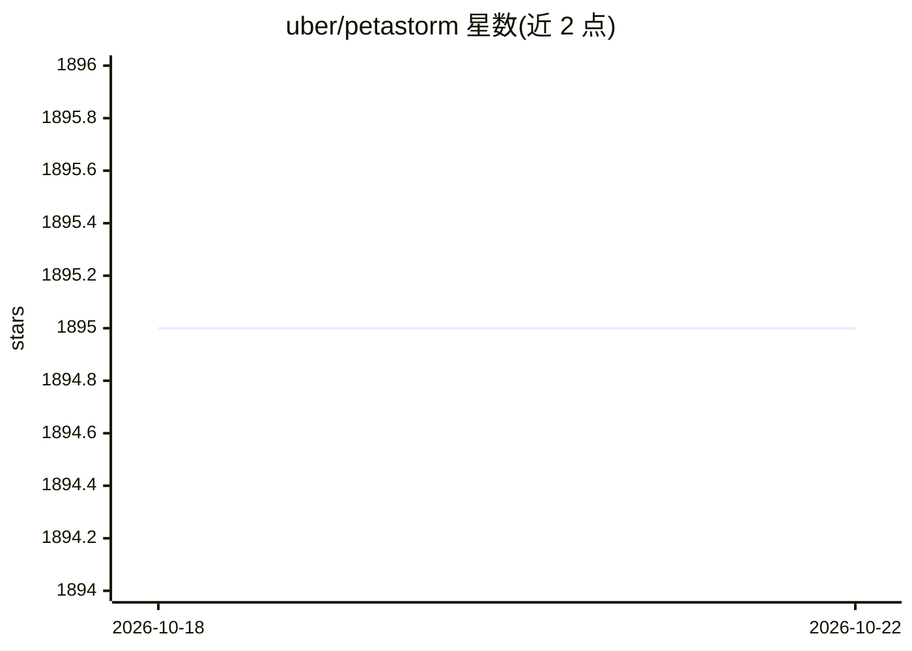

# uber/petastorm

⭐ 1,895 · Python · Apache-2.0 · 推送 2026-01-02 · [GitHub](https://github.com/uber/petastorm) · 组织维护

**供深度学习训练直接读取 Parquet 数据集的数据访问库**

Uber ATG 开发的开源数据访问库：将 Apache Parquet 格式数据集直接接入单机或分布式深度学习训练与评估，支持 TensorFlow、PyTorch、PySpark 及纯 Python 代码。机制上通过 Unischema 定义字段类型/形状/编解码器，用 PySpark 生成数据集，Reader 提供列选择、行过滤、乱序、多 GPU 分区、本地缓存等读取特性，并有 Spark DataFrame 到 tf.data.Dataset / torch DataLoader 的转换 API。支持 hdfs:// 与 file:// 协议，通过 pip 安装。

## 筛选速览

| 维度 | 判定 | 备注 |
|---|---|---|
| AI 角色 | `ai-ecosystem` | LLM/agent 周边工具 |
| 许可风险 | `permissive` | Apache-2.0 |
| 部署形态 | `library` | 以包/库形式分发 |
| 模型依赖 | — | README 未给出锁定关系 |
| 硬件要求 | — | 无带数字的原话,不猜 |
| 安装摩擦 | `medium` | 含编译或系统依赖之一 |
| 成熟度 | — | 结构信号不足 |

## 能力要点

- 直接从 Apache Parquet 数据集进行单机/分布式训练与评估
- Unischema 自定义模式与可扩展数据编解码器（jpeg/png 等）
- Reader 支持列选择、行过滤、乱序、多 GPU 分区、本地缓存
- Spark Dataset Converter 将 Spark DataFrame 转为 tf.data.Dataset 或 torch DataLoader

## 适用场景

- 用 PyTorch/TensorFlow 直接训练存于 Parquet 的大规模数据集
- 把 Spark DataFrame 转换为深度学习框架的数据加载器
- 多 GPU 训练时对数据集做分区读取

## 场景标签

`MLOps` · 领域:训练与推理

## 证据(README 行号)

> L23: Petastorm is an open source data access library developed at Uber ATG. This library enables single machine or
> L25: format. Petastorm supports popular Python-based machine learning (ML) frameworks such as
> L26: `Tensorflow <http://www.tensorflow.org/>`_, `PyTorch <https://pytorch.org/>`_, and

## 星数曲线

2026-10-18 1,895 → 2026-10-22 1,895（+0）

---
*卡片 v1 · prompt 1.4 · 生成 2026-10-21 · 置信度 high · 依据 README sha `b852efabff3e` · [字段定义](../../DATASET.md)*
