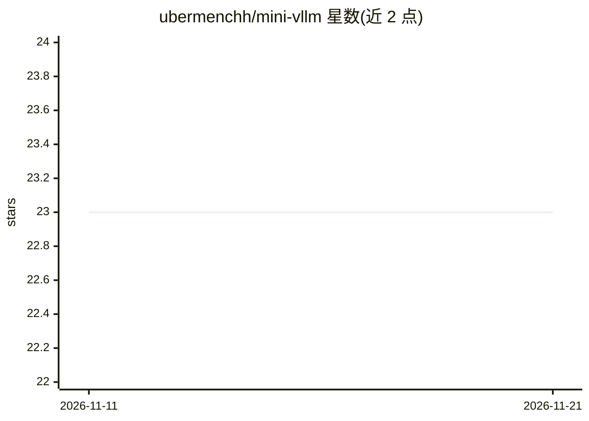

# ubermenchh/mini-vllm

⭐ 23 · Python · MIT · 推送 2026-11-11 · [GitHub](https://github.com/ubermenchh/mini-vllm) · 个人维护

**教学用迷你 vLLM：约 900 行实现 PagedAttention 等推理机制**

用约 900 行 PyTorch + Triton 复现 vLLM 核心思想的 LLM 推理引擎，面向想理解 vLLM 内部机制的开发者。实现 PagedAttention（固定块 KV 缓存 + 块表 Triton 内核）、continuous batching、chunked prefill 与 prefix caching 四项机制，可运行 Llama 3.2 等 Hugging Face 模型。README 明确声明用于学习而非生产，并给出 A100 上 vLLM 快 4-20 倍的基准对比。需 Python 3.10+ 与 CUDA GPU。

## 筛选速览

| 维度 | 判定 | 备注 |
|---|---|---|
| AI 角色 | `ai-ecosystem` | LLM/agent 周边工具 |
| 许可风险 | `permissive` | MIT |
| 部署形态 | `library` | 以包/库形式分发 |
| 模型依赖 | — | README 未给出锁定关系 |
| 硬件要求 | — | 无带数字的原话,不猜 |
| 安装摩擦 | `medium` | 含编译或系统依赖之一 |
| 成熟度 | — | 结构信号不足 |

## 能力要点

- PagedAttention：固定块 KV 缓存，Triton 内核经块表读取
- continuous batching：调度器逐步增删请求，批不等待最慢请求
- chunked prefill：长提示分块处理，不阻塞其他请求解码
- prefix caching：KV 块哈希，共享前缀的请求复用块

## 适用场景

- 学习 vLLM 的 PagedAttention 与连续批处理实现原理
- 阅读可读性优先的小型推理引擎源码
- 在 CUDA GPU 上跑通 Llama 3.2 等模型对比机制效果

## 场景标签

`推理引擎` `教程课程` · 领域:学习与行业

## 证据(README 行号)

> L5: A minimal implementation of vLLM's core ideas: PagedAttention and continuous batching.
> L9: mini-vllm is a small, readable LLM inference engine (~900 lines of Python), built to learn how vLLM works inside. It
> L16: It is for learning, not production. vLLM is 4–20x faster (see Benchmarks).

## 星数曲线

2026-11-11 23 → 2026-11-21 23（+0）

---
*卡片 v1 · prompt 1.4 · 生成 2026-11-18 · 置信度 high · 依据 README sha `57b6c24076f5` · [字段定义](../../DATASET.md)*
