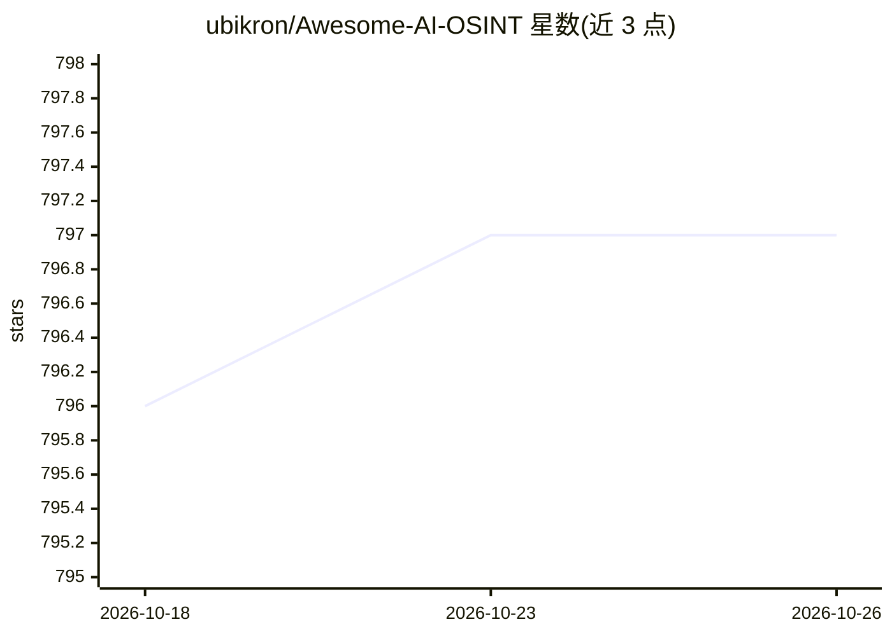

# ubikron/Awesome-AI-OSINT

⭐ 797 · 推送 2026-05-05 · [GitHub](https://github.com/ubikron/Awesome-AI-OSINT) · 组织维护

**AI 用于开源情报（OSINT）的文章、视频与工具清单**

由 Ubikron 维护的 Awesome 类聚合清单，收录与 AI 结合的开源情报资料：按 ChatGPT/Grok/Claude 等模型分类的教程文章与视频、Claude/OpenClaw 技能模板、MCP 服务器，以及覆盖图像反搜、AI GEOINT、人脸搜索、子域名枚举、AI 生成内容检测、暗网工具等类别的工具条目，另含对 AI 局限的批评性文章。面向 OSINT 分析师与调查相关人员，仅做链接编目，不提供安装或运行。

## 筛选速览

| 维度 | 判定 | 备注 |
|---|---|---|
| AI 角色 | `ai-knowledge` | 知识聚合/清单类 |
| 许可风险 | `none` | — |
| 部署形态 | `None` |  |
| 模型依赖 | — | README 未给出锁定关系 |
| 硬件要求 | — | 无带数字的原话,不猜 |
| 安装摩擦 | `low` | 无编译、无系统依赖或容器化 |
| 成熟度 | — | 结构信号不足 |

## 能力要点

- 按 ChatGPT/Grok/Claude 等模型分类整理 OSINT 教程与视频
- 收录 Claude/OpenClaw OSINT 技能模板与 MCP 服务器条目
- 工具条目覆盖图像反搜、GEOINT、人脸搜索、深伪检测等类别

## 适用场景

- 查找各 AI 模型用于 OSINT 调查的教程与提示词技巧
- 为 agent 框架寻找 OSINT 技能模板与 MCP 服务器
- 按任务类型（图像、人脸、子域名、深伪检测）检索 AI OSINT 工具

## 场景标签

`精选清单` · 领域:学习与行业

## 证据(README 行号)

> L5: A list of articles, videos, and tools related to the use of AI for OSINT.
> L66: ## MCP servers

## 星数曲线

2026-10-18 796 → 2026-10-26 797（+1）

---
*卡片 v1 · prompt 1.4 · 生成 2026-10-21 · 置信度 high · 依据 README sha `f108d53edb96` · [字段定义](../../DATASET.md)*
