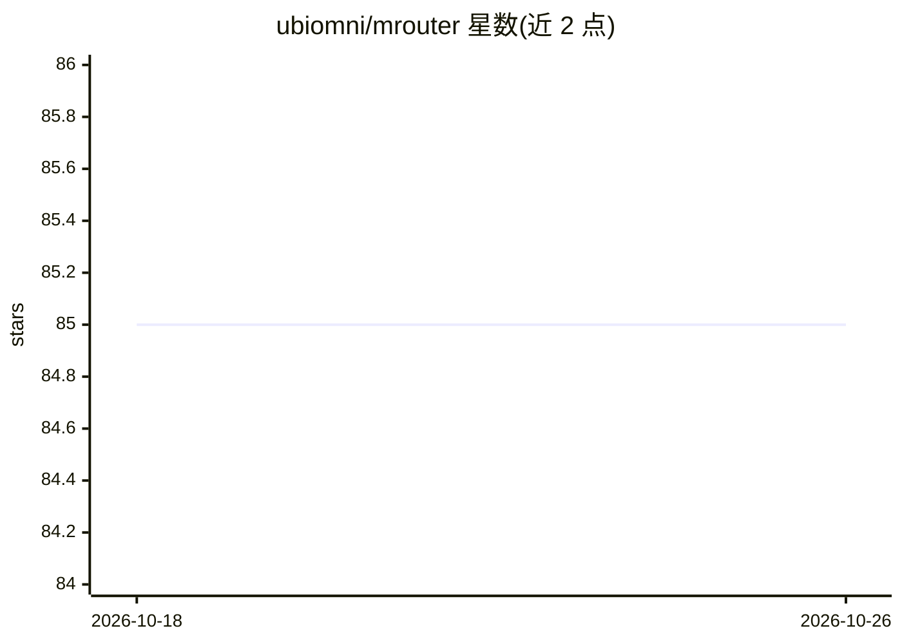

# ubiomni/mrouter

⭐ 85 · Rust · MIT · 推送 2026-10-12 · [GitHub](https://github.com/ubiomni/mrouter) · 组织维护 · 中文 README

**终端原生的 LLM 网关：统一端点多提供商路由、故障转移与监控**

面向在服务器上访问多个 AI 提供商的开发者的 LLM 网关路由器：应用程序只需指向单一端点 localhost:4444，MRouter 按模型名自动路由到对应提供商，失败时自动切换备选并内置断路器。支持 Anthropic↔OpenAI 双向协议转换，可让任意客户端对接任意提供商。以 TUI 形式通过 SSH 管理提供商、查看请求日志与 Token/成本统计，并可自动同步配置到 Claude Code、Codex、Gemini CLI 等工具。通过 git clone 源码安装。

## 筛选速览

| 维度 | 判定 | 备注 |
|---|---|---|
| AI 角色 | `ai-ecosystem` | LLM/agent 周边工具 |
| 许可风险 | `permissive` | MIT |
| 部署形态 | `None` |  |
| 模型依赖 | locked-api |  |
| 硬件要求 | — | 无带数字的原话,不猜 |
| 安装摩擦 | `low` | 无编译、无系统依赖或容器化 |
| 成熟度 | — | 结构信号不足 |

## 能力要点

- 按模型名自动路由到正确提供商，单端点 localhost:4444
- 自动故障转移与断路器（Closed/Open/Half-Open）
- Anthropic ↔ OpenAI 协议双向自动转换（含 SSE 流）
- TUI 经 SSH 管理提供商/日志/统计，配置一键同步到 5 种 CLI 工具
- 按提供商的 Token 用量与自定义定价成本统计

## 适用场景

- 服务器应用统一网关，免于每个应用单独配置各提供商 API key
- 在远程服务器上通过 SSH 终端管理 AI 路由与查看统计
- 用 Claude Code 等 Anthropic 客户端访问 DeepSeek 等 OpenAI 格式提供商
- 多提供商之间自动故障转移保障服务可用性

## 场景标签

`模型网关` · 领域:Agent 开发

## 证据(README 行号)

> L7: One endpoint for every AI provider — smart routing, auto failover, zero-config CLI sync. Built as a terminal-native 
> L45: - 🚀 **Provider Management** - Manage multiple AI providers (Anthropic, OpenAI, Google, AWS Bedrock, etc.)
> L52: - 🔌 **LLM Gateway Proxy** - Unified proxy endpoint for all CLI tools

## 星数曲线

2026-10-18 85 → 2026-10-26 85（+0）

---
*卡片 v1 · prompt 1.4 · 生成 2026-10-24 · 置信度 high · 依据 README sha `ab9049953c4c` · [字段定义](../../DATASET.md)*
