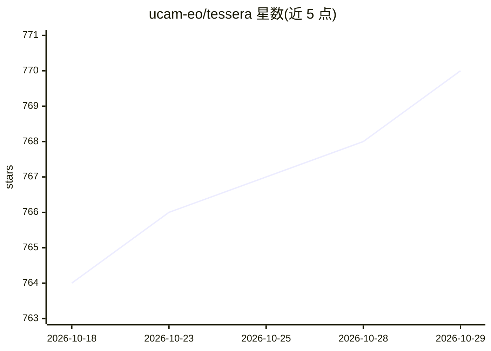

# ucam-eo/tessera

⭐ 770 · Python · MIT · 推送 2026-08-17 · [GitHub](https://github.com/ucam-eo/tessera) · 组织维护

**面向时序卫星影像的地球观测基础模型，用于地表分类等任务**

剑桥大学开发的开放基础模型 TESSERA（CVPR 2026），将 Sentinel-1/2 时序卫星数据压缩为全球 10 米分辨率的 128 维逐像素嵌入，采用 Barlow Twins 自监督对齐云下随机样本以应对云污染与缺失观测。嵌入权重以 CC0 发布，软件为 MIT 许可。已生成全球 2024 年嵌入，美欧覆盖 2017–2025，可通过 GeoTessera 库直接下载；也可自行运行预处理与推理流水线生成嵌入，但需大量存储（100km×100km 区域约 1TB）与至少 128GB RAM，仅在 Linux/WSL 上测试。

## 筛选速览

| 维度 | 判定 | 备注 |
|---|---|---|
| AI 角色 | `ai-native` | 本体是模型或模型工具 |
| 许可风险 | `permissive` | MIT |
| 部署形态 | `self-host` | docker 或自建部署 |
| 模型依赖 | — | README 未给出锁定关系 |
| 硬件要求 | — | 无带数字的原话,不猜 |
| 安装摩擦 | `low` | 无编译、无系统依赖或容器化 |
| 成熟度 | `idea` | |

## 能力要点

- 自监督学习生成全球 10m 分辨率 128 维逐像素嵌入
- 预计算嵌入可通过 GeoTessera 直接下载使用
- 支持 Sentinel-1（VV/VH）与 Sentinel-2（10 波段）时序数据
- 提供 shapefile 转 TIFF 脚本等流水线工具

## 适用场景

- 生成本区域卫星时序的像素级嵌入用于下游建模
- 直接下载预计算嵌入做栖息地制图、作物分类等任务
- 生态环境动态与变化检测研究

## 场景标签

`图像视频处理` · 领域:感知与多模态

## 证据(README 行号)

> L35: This idea is the key behind TESSERA, an open foundation model that preserves per-pixel spectral-temporal signals in
> L47: * Z. Feng, C. Atzberger, S. Jaffer, J. Knezevic, S. Sormunen, R. Young, M.C. Lisaius, M. Immitzer, T. Jackson, J. B

## 星数曲线

2026-10-18 764 → 2026-10-29 770（+6）

---
*卡片 v1 · prompt 1.4 · 生成 2026-10-21 · 置信度 mid · 依据 README sha `4a3ee80d0c75` · [字段定义](../../DATASET.md)*
