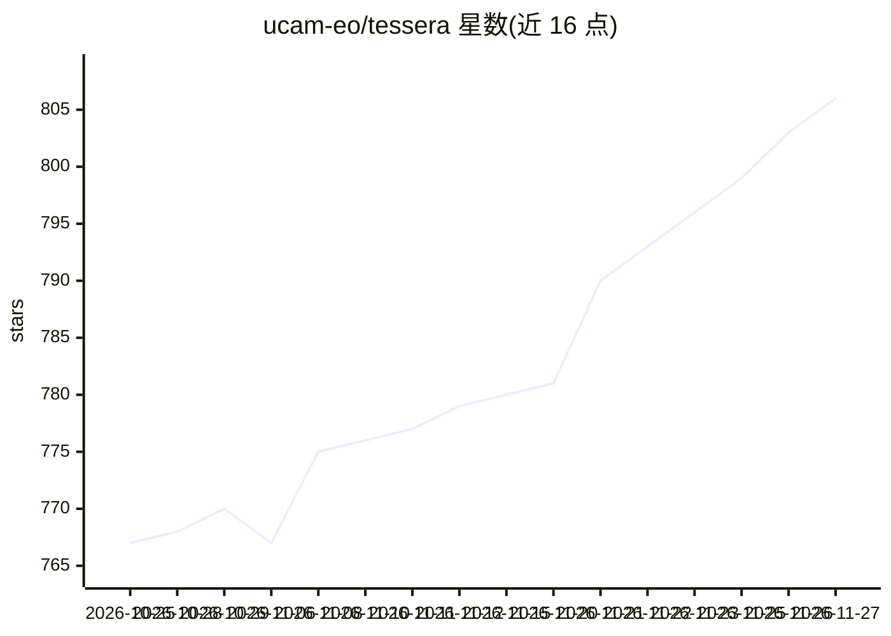

# ucam-eo/tessera

⭐ 806 · Python · MIT · 推送 2026-11-12 · [GitHub](https://github.com/ucam-eo/tessera) · 组织维护

**为遥感研究者提供卫星时序数据的自监督嵌入基础模型**

剑桥大学开发的地球观测基础模型，将 Sentinel-1/2 卫星时序数据经 Barlow Twins 自监督训练压缩为 10 米分辨率的 128 维逐像素嵌入。提供两条使用路径：通过 GeoTessera 库下载 2017–2025 年全球预计算嵌入用于下游任务（土地分类、树冠高度预测等）；或自建管线生成嵌入，后者需大量计算与存储资源。软件 MIT 许可，嵌入与权重 CC0 许可。

## 筛选速览

| 维度 | 判定 | 备注 |
|---|---|---|
| AI 角色 | `ai-native` | 本体是模型或模型工具 |
| 许可风险 | `permissive` | MIT |
| 部署形态 | `self-host` | docker 或自建部署 |
| 模型依赖 | — | README 未给出锁定关系 |
| 硬件要求 | — | 无带数字的原话,不猜 |
| 安装摩擦 | `low` | 无编译、无系统依赖或容器化 |
| 成熟度 | — | 结构信号不足 |

## 能力要点

- 10 米分辨率全球年度覆盖的 128 维逐像素时序嵌入
- 预计算嵌入可通过 GeoTessera/tessera-embeddings 库直接下载使用
- 支持 Sentinel-1 与 Sentinel-2 十波段时序输入
- 配套多篇论文与 arXiv 预印本说明方法细节

## 适用场景

- 生成土地分类、树冠高度等下游任务所需的嵌入
- 下载全球预计算嵌入节省计算成本
- 处理云污染的卫星时序数据提取物候信息

## 场景标签

`科研工具` · 领域:学习与行业

## 证据(README 行号)

> L35: This idea is the key behind TESSERA, an open foundation model that preserves per-pixel spectral-temporal signals in
> L78: We have generated Tessera v1.1 embeddings for the whole globe at 10m resolution from 2017 to 2025.
> L90: If you would like to use our software to create your own embeddings, please follow the instructions below. Note tha

## 星数曲线

2026-10-25 767 → 2026-11-27 806（+39）

---
*卡片 v1 · prompt 1.4 · 生成 2026-11-24 · 置信度 high · 依据 README sha `fdefd4dfa847` · [字段定义](../../DATASET.md)*
