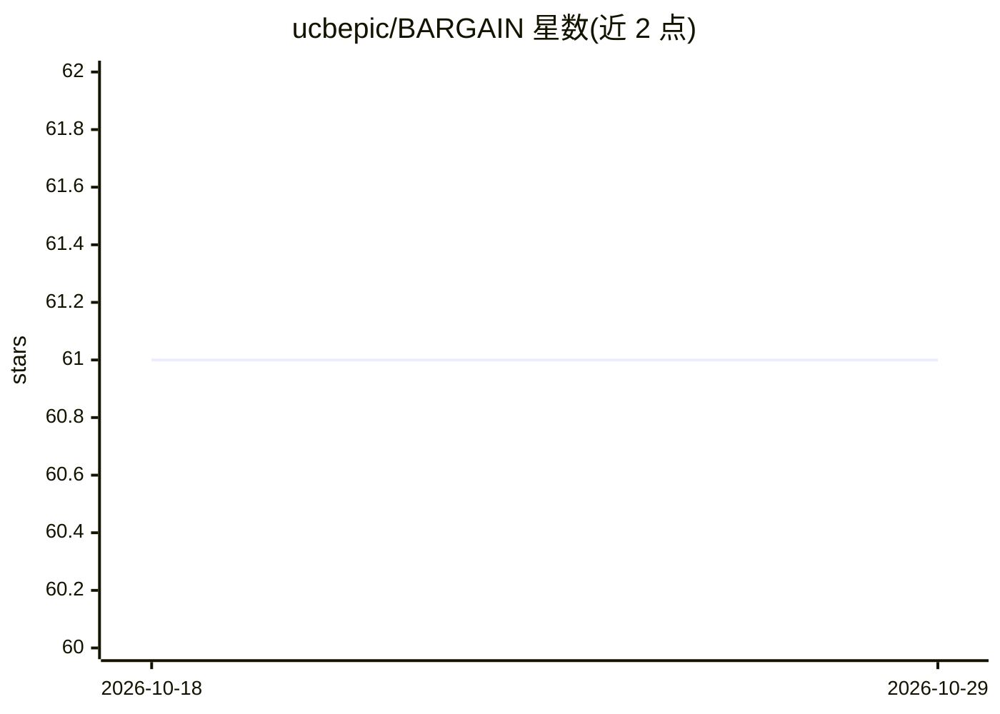

# ucbepic/BARGAIN

⭐ 61 · Python · MIT · 推送 2026-06-11 · [GitHub](https://github.com/ucbepic/BARGAIN) · 组织维护

**给开发者的 LLM 数据处理降本库：级联便宜与昂贵模型并保证准确率**

面向用 LLM 批量处理数据集的开发者，BARGAIN 采用模型级联框架：先对每条记录运行便宜的 proxy 模型，依据输出对数概率与级联阈值决定是否信任，否则调用昂贵的 oracle 模型。通过预处理阶段的自适应采样与统计估计确定阈值，在用户给定精度目标下保证输出至少 T% 与 oracle 一致。支持二分类与开放式任务，可通过继承 Proxy/Oracle 类接入非 OpenAI 服务；另支持带预算约束的 precision/recall 目标（BARGAIN_P/BARGAIN_R）。以 pip 包提供，附 SIGMOD'26 论文。

## 筛选速览

| 维度 | 判定 | 备注 |
|---|---|---|
| AI 角色 | `ai-ecosystem` | LLM/agent 周边工具 |
| 许可风险 | `permissive` | MIT |
| 部署形态 | `library` | 以包/库形式分发 |
| 模型依赖 | — | README 未给出锁定关系 |
| 硬件要求 | — | 无带数字的原话,不猜 |
| 安装摩擦 | `low` | 无编译、无系统依赖或容器化 |
| 成熟度 | — | 结构信号不足 |

## 能力要点

- 模型级联：proxy 输出 logprob 超过级联阈值则免调昂贵模型
- 给定 target/delta，统计保证输出至少 T% 匹配 oracle
- 自适应采样预处理确定阈值，支持任意样本规模
- BARGAIN_P/BARGAIN_R 支持带 oracle 调用预算的 precision/recall 目标

## 适用场景

- 大规模数据集用 LLM 标注时控制 API 成本
- 需要准确率保证的分类或开放式抽取任务
- 接入自定义模型调用机制处理非 OpenAI 服务

## 场景标签

`模型网关` `数据分析` · 领域:Agent 开发

## 证据(README 行号)

> L3: BARGAIN helps reduce cost when processing a dataset using LLMs. It automatically decides whether to use a cheap and 
> L8: BARGAIN follows the _model cascade_ framework. To process a data record with an LLM given a prompt, it first runs th
> L38: from BARGAIN import OpenAIProxy, OpenAIOracle, BARGAIN_A

## 星数曲线

2026-10-18 61 → 2026-10-29 61（+0）

---
*卡片 v1 · prompt 1.4 · 生成 2026-10-24 · 置信度 high · 依据 README sha `12dd97b40bac` · [字段定义](../../DATASET.md)*
