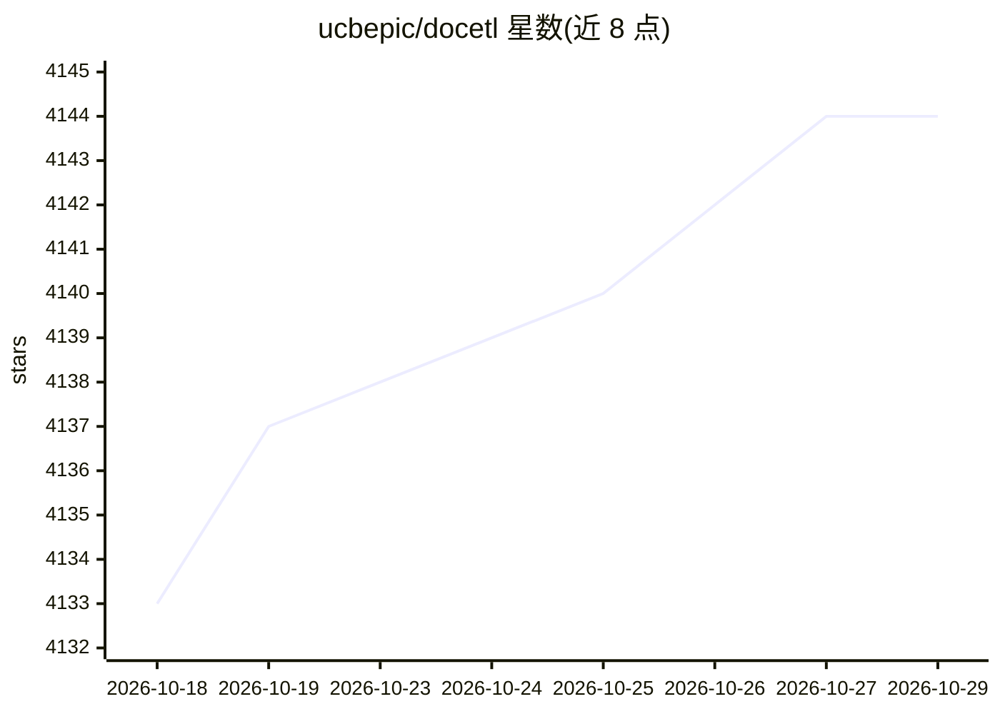

# ucbepic/docetl

⭐ 4,144 · Python · MIT · 推送 2026-10-09 · [GitHub](https://github.com/ucbepic/docetl) · [官网](https://docetl.org) · 组织维护

**LLM 驱动的声明式数据处理与 ETL 系统**

用自然语言定义操作（map/reduce/filter 等），由 LLM 执行大规模结构化与非结构化数据的处理流水线，并自动优化：换模型、改写提示词、分解操作、以代码替换子任务以提升准确率并降低成本，输出可查询的表。提供 Python API、YAML 低代码声明方式、CLI 与 DocWrangler 可视化交互 UI。由 UC Berkeley EPIC Data Lab 开发，附 VLDB 2025 论文，MIT 许可。

## 筛选速览

| 维度 | 判定 | 备注 |
|---|---|---|
| AI 角色 | `ai-ecosystem` | LLM/agent 周边工具 |
| 许可风险 | `permissive` | MIT |
| 部署形态 | `library` | 以包/库形式分发 |
| 模型依赖 | — | README 未给出锁定关系 |
| 硬件要求 | — | 无带数字的原话,不猜 |
| 安装摩擦 | `medium` | 含编译或系统依赖之一 |
| 成熟度 | — | 结构信号不足 |

## 能力要点

- 自然语言定义 map/reduce/filter 等操作并由 LLM 执行
- 自动流水线优化（换模型、改写提示、分解操作、以代码替换子任务）
- Python API / YAML / CLI / DocWrangler UI 多种使用方式
- 配套三篇论文（DocETL VLDB 2025、DocWrangler UIST 2025、MOAR）

## 适用场景

- 对大量文档做抽取、归并、过滤等 LLM 处理
- 以低代码 YAML 声明数据处理流水线并自动调优
- 在可视化 UI 中交互式开发提示词与流水线

## 场景标签

`文档解析` `数据分析` · 领域:效率与自动化

## 证据(README 行号)

> L12: DocETL helps you process large collections of data (structured and unstructured) with LLMs. You write each operatio
> L15: - optimizes your pipeline automatically, swapping models, rewriting prompts, decomposing operations, and replacing 

## 星数曲线

2026-10-18 4,133 → 2026-10-29 4,144（+11）

---
*卡片 v1 · prompt 1.4 · 生成 2026-10-20 · 置信度 high · 依据 README sha `7c9ec4b9bf0b` · [字段定义](../../DATASET.md)*
