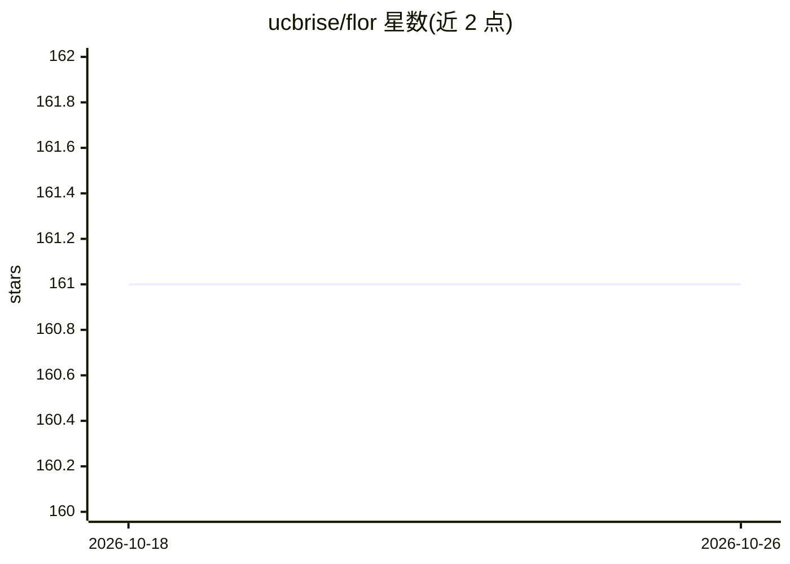

# ucbrise/flor

⭐ 161 · Jupyter Notebook · Apache-2.0 · 推送 2026-10-08 · [GitHub](https://github.com/ucbrise/flor) · [官网](https://rlnsanz.github.io) · 组织维护

**面向 ML 训练与评估的实验追踪与复盘日志库**

FlorDB 是 Python 实验追踪库：在训练脚本中 import flordb 即可捕获 print/logging 输出并关联产生它的代码；flor.arg 记录超参数、flor.log 记录指标，可用 flor.dataframe() 查询对比；在 Git 中以 flor. 分支自动提交版本，支持加载历史 checkpoint 评估、以及事后补加日志语句重放历史运行（hindsight logging）以补录指标。基于 UC Berkeley RISE Lab 与 ASU 的研究，提供 CIDR/PVLDB 论文。限制：自动版本管理需 Git 仓库。

## 筛选速览

| 维度 | 判定 | 备注 |
|---|---|---|
| AI 角色 | `ai-ecosystem` | LLM/agent 周边工具 |
| 许可风险 | `permissive` | Apache-2.0 |
| 部署形态 | `library` | 以包/库形式分发 |
| 模型依赖 | — | README 未给出锁定关系 |
| 硬件要求 | — | 无带数字的原话,不猜 |
| 安装摩擦 | `low` | 无编译、无系统依赖或容器化 |
| 成熟度 | — | 结构信号不足 |

## 能力要点

- 一行 import 捕获 print/logging 输出并可查询（flor.io()）
- 在专属 git 分支自动提交运行版本，记录超参与指标
- 事后补加日志语句并重放历史运行补录指标（hindsight replay）
- 加载历史 checkpoint 在 Jupyter 中评估模型

## 适用场景

- 训练脚本中最低成本地记录每次运行的输出与超参数
- 跨运行对比实验指标与超参数
- 漏记指标时通过重放历史运行补录数据
- 加载历史 checkpoint 做事后模型评估

## 场景标签

`MLOps` · 领域:训练与推理

## 证据(README 行号)

> L5: FlorDB starts with the `print` and `logging` output of the scripts you already run as part of model training, and, o
> L71: In a training script, use `flor.arg(n, v)` for hyper-parameters and `flor.log(n, v)` for
> L173: FlorDB is based on research from UC Berkeley’s RISE Lab continued at Arizona State University.

## 星数曲线

2026-10-18 161 → 2026-10-26 161（+0）

---
*卡片 v1 · prompt 1.4 · 生成 2026-10-22 · 置信度 high · 依据 README sha `68dc0b24e180` · [字段定义](../../DATASET.md)*
