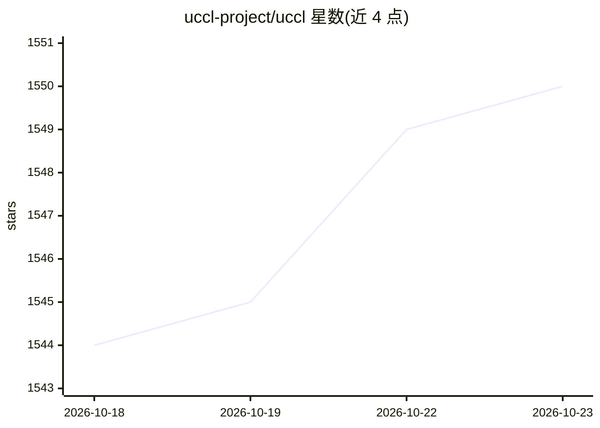

# uccl-project/uccl

⭐ 1,550 · C++ · Apache-2.0 · 推送 2026-10-21 · [GitHub](https://github.com/uccl-project/uccl) · [官网](https://uccl-project.github.io/) · 组织维护

**面向 GPU 集合通信/P2P/EP 的通信库，可替换 NCCL/RCCL**

由 UC Berkeley Sky Computing Lab 与 UC Davis ArtSy Lab 开发的 GPU 通信库，含三个组件：UCCL-collective（保持 NCCL API 的 drop-in 替代，软件层包喷洒与拥塞控制）、UCCL-P2P（NIXL 风格的点对点传输，面向 800Gbps NIC，用于 KV cache/RL 权重传输）、UCCL-EP（在异构硬件上运行 DeepEP 的专家并行通信）。支持 Nvidia/AMD GPU 与 RDMA/EFA/TCP 等网络。需通过 build.sh 按平台编译构建，也提供 Docker 镜像路径；TPU/Trainium 等加速器尚未支持。

## 筛选速览

| 维度 | 判定 | 备注 |
|---|---|---|
| AI 角色 | `ai-ecosystem` | LLM/agent 周边工具 |
| 许可风险 | `permissive` | Apache-2.0 |
| 部署形态 | `desktop` | 安装包/桌面程序 |
| 模型依赖 | — | README 未给出锁定关系 |
| 硬件要求 | — | 无带数字的原话,不猜 |
| 安装摩擦 | `high` | 编译与系统依赖俱全 |
| 成熟度 | — | 结构信号不足 |

## 能力要点

- UCCL-collective 保持 NCCL API，应用代码无需修改即可替换
- 软件层包喷洒（256 路径）与延迟/接收方驱动的拥塞控制
- UCCL-P2P/EP 支持异构 GPU（Nvidia/AMD）与多厂商 NIC（Broadcom/AWS EFA）
- 被 NeMo、NIXL、llm-d、TheRock 等项目采用

## 适用场景

- 分布式 LLM 训练/推理中替换 NCCL 获得通信性能收益
- MoE 专家并行通信在异构 GPU/NIC 上运行
- KV cache 与 RL 权重的跨节点点对点传输

## 场景标签

 · 领域:分布式系统/GPU 网络

## 证据(README 行号)

> L10: UCCL is an efficient communication library for GPUs, covering collectives, P2P (e.g., KV cache transfer, RL weight 
> L16: * **UCCL-collective** (UCCL-Tran) serves as a drop-in replacement for NCCL/RCCL (e.g., requiring no changes to appl

## 星数曲线

2026-10-18 1,544 → 2026-10-23 1,550（+6）

---
*卡片 v1 · prompt 1.4 · 生成 2026-10-21 · 置信度 mid · 依据 README sha `9c249031e176` · [字段定义](../../DATASET.md)*
