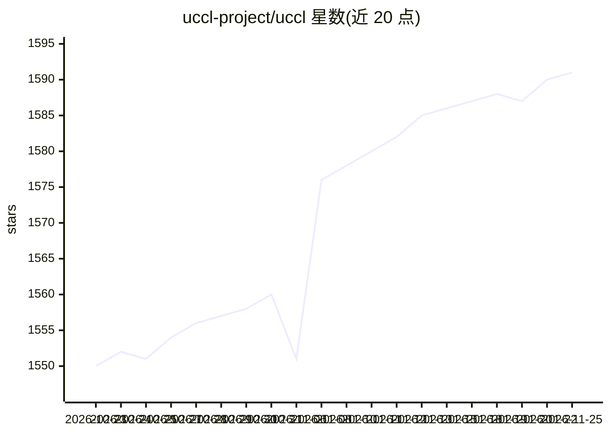

# uccl-project/uccl

⭐ 1,591 · C++ · Apache-2.0 · 推送 2026-11-21 · [GitHub](https://github.com/uccl-project/uccl) · [官网](https://uccl-project.github.io/) · 组织维护

**面向 GPU 通信的库：集合通信、P2P 传输与 EP 通信**

UCCL 提供 GPU 间通信能力，包含三个组件：UCCL-collective 作为 NCCL/RCCL 的替换方案（保持 NCCL API）、UCCL-P2P 提供 NIXL 风格的 initiator-target 传输 API（用于 KV cache 与 RL 权重传输）、UCCL-EP 提供 DeepEP 兼容的专家并行通信 API。支持 NVIDIA/AMD GPU 与 NVIDIA/Broadcom/AWS EFA 等多种 NIC，通过 build.sh 按平台构建，以 NCCL net plugin 或 Python 绑定方式接入 PyTorch 应用。由 UC Berkeley 与 UC Davis 实验室开发。

## 筛选速览

| 维度 | 判定 | 备注 |
|---|---|---|
| AI 角色 | `ai-ecosystem` | LLM/agent 周边工具 |
| 许可风险 | `permissive` | Apache-2.0 |
| 部署形态 | `desktop` | 安装包/桌面程序 |
| 模型依赖 | — | README 未给出锁定关系 |
| 硬件要求 | — | 无带数字的原话,不猜 |
| 安装摩擦 | `high` | 编译与系统依赖俱全 |
| 成熟度 | — | 结构信号不足 |

## 能力要点

- UCCL-collective 保持 NCCL API，可作为插件接入 PyTorch 应用
- UCCL-P2P 提供 NIXL 风格 initiator-target 传输 API
- UCCL-EP 提供 DeepEP 兼容 API，支持 AMD/NVIDIA GPU 与多种 RDMA NIC
- build.sh 按平台自动检测 Python 版本，支持 cu12/cu13/rocm 目标

## 适用场景

- 为 PyTorch 分布式训练替换集合通信后端
- 跨节点 KV cache 传输与 RL 权重同步
- MoE 训练与推理中的专家并行通信
- 在 AMD/NVIDIA 异构环境与多种 NIC 上运行通信

## 场景标签

 · 领域:ML 基础设施/GPU 通信

## 证据(README 行号)

> L10: UCCL is an efficient communication library for GPUs, covering collectives, P2P (e.g., KV cache transfer, RL weight 
> L85: Then, when running your PyTorch applications, set the environment variable accordingly:
> L143: * NVIDIA NIXL inference transfer library integrates UCCL-P2P as a RDMA backend: release page.

## 星数曲线

2026-10-23 1,550 → 2026-11-25 1,591（+41）

---
*卡片 v1 · prompt 1.4 · 生成 2026-11-23 · 置信度 high · 依据 README sha `81dca699f925` · [字段定义](../../DATASET.md)*
