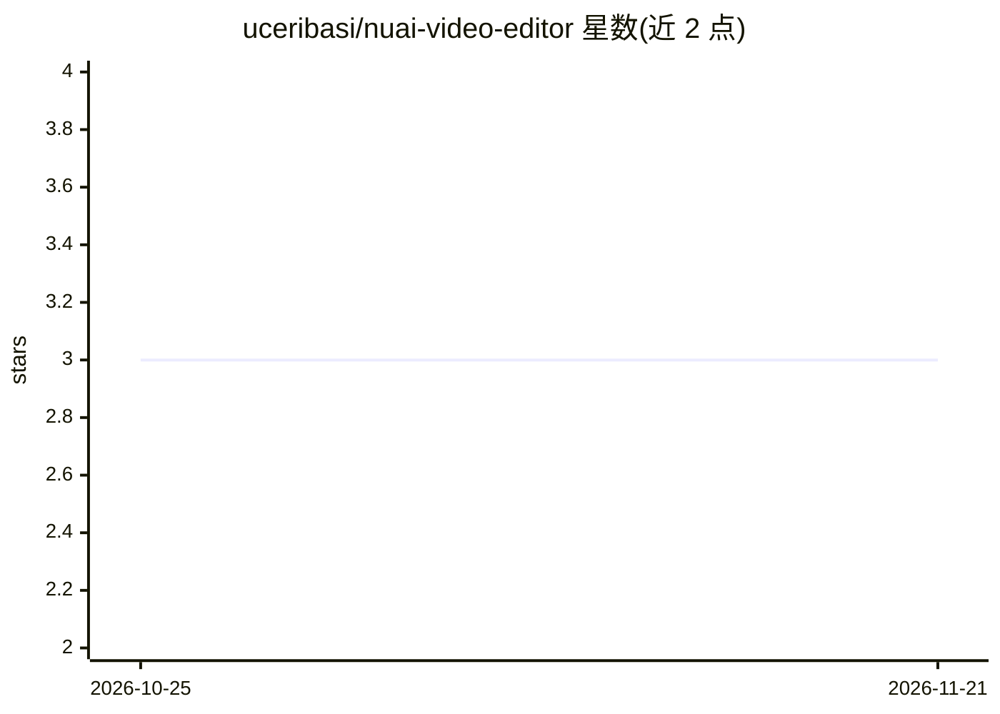

# uceribasi/nuai-video-editor

⭐ 3 · Rust · MIT · 推送 2026-10-31 · [GitHub](https://github.com/uceribasi/nuai-video-editor) · [官网](https://github.com/uceribasi/nuai-video-editor) · 个人维护 · 中文 README

**macOS 开源视频剪辑器：自动删停顿口水词、生成翻译字幕并同声配音**

基于 Tauri 2 + Rust 的 macOS 桌面视频编辑器，通过本地测量实现自动清理：Silero VAD 检测停顿、whisper.cpp 生成词级时间戳转录、ffmpeg freezedetect 找冻结画面，AI 仅读取转录文本输出要删除的短语 id；语言模型接入可选，除 AI 复核与翻译外全部功能无需 AI。字幕支持 SRT/VTT 导出、多语言可选轨或烧录，配音（beta）从视频本身克隆说话人声音朗读翻译字幕。剪裁建议需在转录与时间线上人工复核后导出。

## 筛选速览

| 维度 | 判定 | 备注 |
|---|---|---|
| AI 角色 | `ai-enhanced` | 去掉 AI 部分产品仍成立 |
| 许可风险 | `permissive` | MIT |
| 部署形态 | `desktop` | 安装包/桌面程序 |
| 模型依赖 | local-ok | 支持本地模型 |
| 硬件要求 | — | 无带数字的原话,不猜 |
| 安装摩擦 | `high` | 编译与系统依赖俱全 |
| 成熟度 | — | 结构信号不足 |

## 能力要点

- 本地测量为主的自动清理：VAD 停顿检测、whisper.cpp 转录、ffmpeg 冻结画面检测
- AI 仅读转录文本输出删除建议，可接入 Codex/Claude/OpenAI/Ollama 等多种后端
- 翻译字幕多轨导出（SRT/VTT/MP4 可选轨/烧录）
- beta 配音：从视频克隆说话人声音，保留原音乐与背景音

## 适用场景

- 把录课/播客录像里的停顿、重录和口头语一键剪掉
- 给视频生成跟随剪辑点的多语言字幕
- 用说话人自己的声音给视频做外语配音
- 本地离线处理，敏感录音不出电脑

## 场景标签

`语音合成` `语音识别` · 领域:内容生成

## 证据(README 行号)

> L5:  The open-source AI video editor that cleans up your recordings.
> L37:  works without any AI.
> L59: is measured locally; the language model only reads a transcript and answers with the

## 星数曲线

2026-10-25 3 → 2026-11-21 3（+0）

---
*卡片 v1 · prompt 1.4 · 生成 2026-11-21 · 置信度 mid · 依据 README sha `90e50999c0f0` · [字段定义](../../DATASET.md)*
