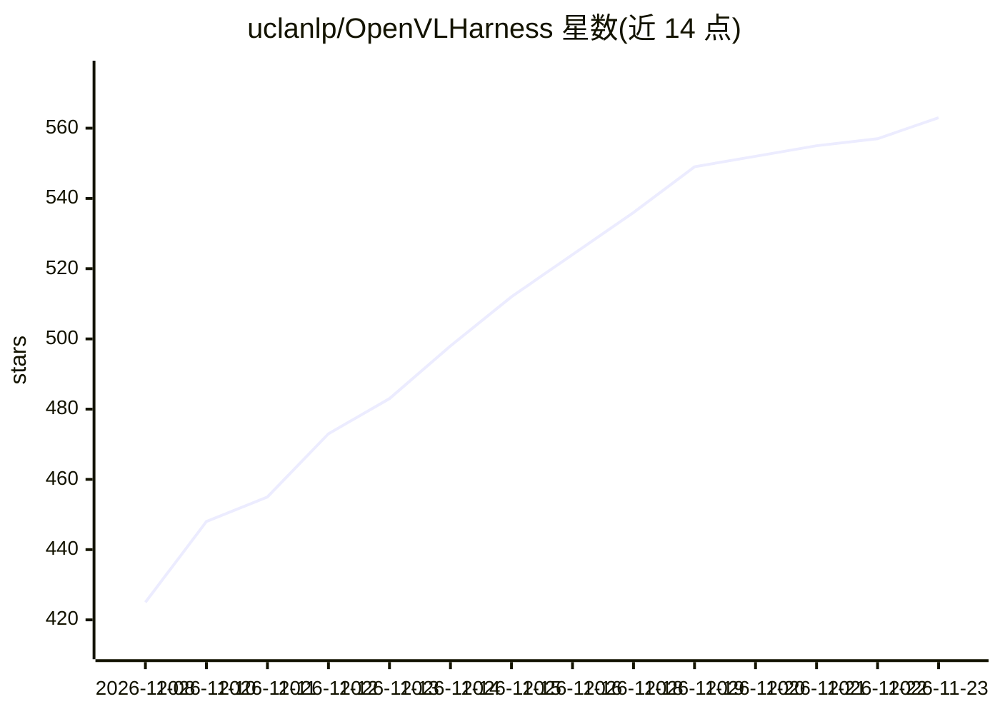

# uclanlp/OpenVLHarness

⭐ 563 · Python · MIT · 推送 2026-11-10 · [GitHub](https://github.com/uclanlp/OpenVLHarness) · [官网](https://openvlharness.github.io/) · 组织维护

**给 MLLM 加视觉工具与多模态记忆的免训练 agent 框架**

UCLA NLP 发布的视觉 agent 工具层：让任意多模态大模型通过原生 tool calling 调用九种能力（视觉定位、OCR、深度估计、放大裁剪、文本/图像搜索、网页访问、Python 编码代理等），并以多模态记忆让图像、框、掩码、深度图与网页引用在整个问题内保持可寻址，供后续工具与代码复用。免微调，直接使用骨干模型现有权重。默认后端包括 SAM 3、PaddleOCR-VL、Depth Anything 3、Serper 搜索与 Qwen3-VL-8B 辅助模型；各模型服务需独立部署（含 GPU 服务），搜索工具需 Serper API key。源码安装，附带评测框架与 22 个基准的结果。

## 筛选速览

| 维度 | 判定 | 备注 |
|---|---|---|
| AI 角色 | `ai-ecosystem` | LLM/agent 周边工具 |
| 许可风险 | `permissive` | MIT |
| 部署形态 | `library` | 以包/库形式分发 |
| 模型依赖 | — | README 未给出锁定关系 |
| 硬件要求 | — | 无带数字的原话,不猜 |
| 安装摩擦 | `low` | 无编译、无系统依赖或容器化 |
| 成熟度 | — | 结构信号不足 |

## 能力要点

- 九种能力层接口，覆盖定位/OCR/深度/搜索/编码等任务
- 多模态记忆使图像、掩码、深度图等证据跨步骤可寻址
- 免训练：通过骨干模型原生 tool calling 工作，支持任意注册模型
- 22 个基准上七个骨干平均提升 9.7-12.6 分

## 适用场景

- 让自选的 MLLM 在视觉问答中调用定位、OCR、深度估计等工具
- 构建需要跨步骤累积视觉证据的视觉 agent 应用
- 复现论文基准评测或做视觉工具使用研究

## 场景标签

`Agent 框架` `多模态` `Agent 记忆` · 领域:Agent 开发

## 证据(README 行号)

> L19:  Teach any MLLM to think and code in visual space with precise multimodal evidence
> L55: The model chooses tools, inspects their evidence, and continues until it can answer.
> L58: - **Capability layer:** nine task-level interfaces turn tool outputs into readable

## 星数曲线

2026-11-08 425 → 2026-11-23 563（+138）

---
*卡片 v1 · prompt 1.4 · 生成 2026-11-17 · 置信度 high · 依据 README sha `0a9a2b1cadca` · [字段定义](../../DATASET.md)*
