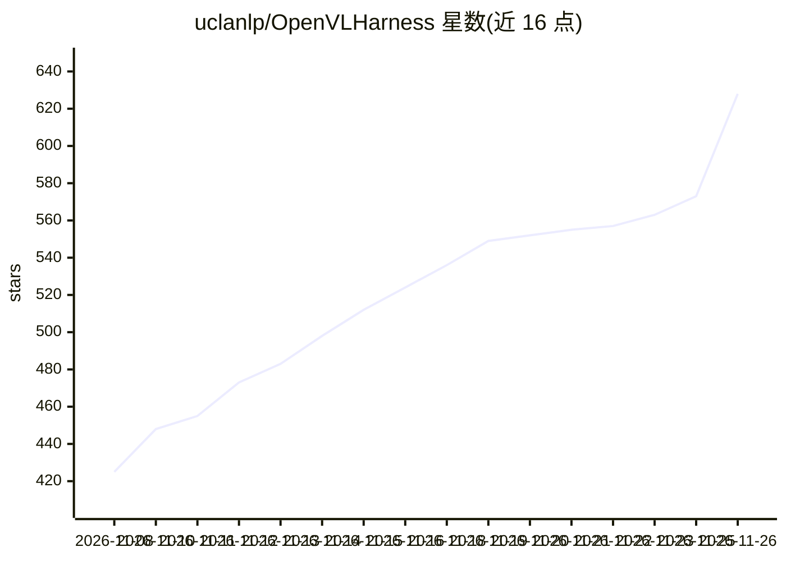

# uclanlp/OpenVLHarness

⭐ 628 · Python · MIT · 推送 2026-11-25 · [GitHub](https://github.com/uclanlp/OpenVLHarness) · [官网](https://openvlharness.github.io/) · 组织维护

**让多模态大模型以工具与代码求解视觉问题的 agent 框架**

论文 OpenVLHarness 的官方代码：一个免训练的多模态 agent 框架，通过九个能力接口（视觉定位、OCR、深度估计、图像/网页搜索、Python 编码等）与多模态记忆（图像、掩码、深度图、网页引用全程可寻址），使 Qwen3-VL、GPT-5/6、Kimi K3 等骨干模型以原生 tool calling 在视觉空间中思考与写代码。面向多模态 agent 研究者，附 22 个基准的评测层（openvlharness-eval）。需自建 GPU 模型服务与 Serper 搜索 API；编码工具在宿主机子进程运行，无沙箱。

## 筛选速览

| 维度 | 判定 | 备注 |
|---|---|---|
| AI 角色 | `ai-ecosystem` | LLM/agent 周边工具 |
| 许可风险 | `permissive` | MIT |
| 部署形态 | `library` | 以包/库形式分发 |
| 模型依赖 | local-ok | 支持本地模型 |
| 硬件要求 | — | 无带数字的原话,不猜 |
| 安装摩擦 | `low` | 无编译、无系统依赖或容器化 |
| 成熟度 | — | 结构信号不足 |

## 能力要点

- 九个任务级能力接口：定位/OCR/深度/相机轨迹/缩放/搜索/网页访问/Python 编码
- 多模态记忆：图像、boxes、masks、深度图与网页引用在整个问题过程中可寻址
- 免训练：通过骨干模型原生 tool calling 运行，不微调权重
- 提供 22 个基准的评测层与可复现采样评测

## 适用场景

- 为视觉问答/定位/空间理解基准复现论文评测
- 在自己的多模态模型上接入工具调用与多模态记忆
- 构建需要定位、深度估计与网络检索组合的多步视觉 agent

## 场景标签

`Agent 框架` `多模态` `模型评测` `编码 Agent` · 领域:Agent 开发

## 证据(README 行号)

> L56: The model chooses tools, inspects their evidence, and continues until it can answer.
> L63: - **Python Coding Agent:** the backbone writes code in a separate context to
> L127: The release includes agent presets for seven of the paper's eight backbones:

## 星数曲线

2026-11-08 425 → 2026-11-26 628（+203）

---
*卡片 v1 · prompt 1.4 · 生成 2026-11-26 · 置信度 high · 依据 README sha `71b1c8623890` · [字段定义](../../DATASET.md)*
