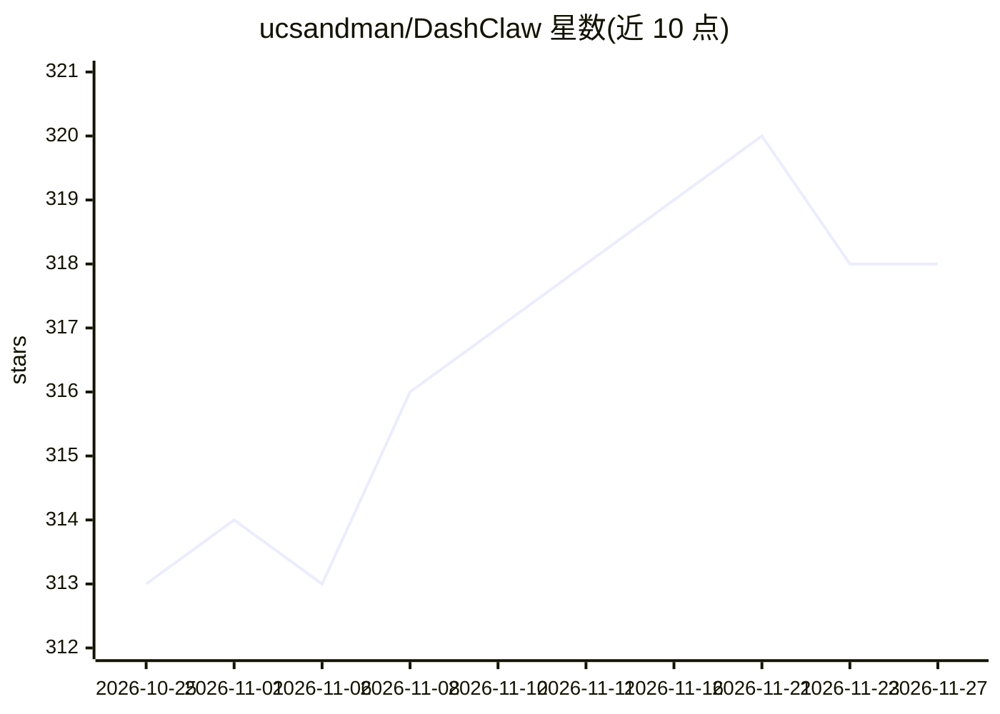

# ucsandman/DashClaw

⭐ 318 · TypeScript · MIT · 推送 2026-11-26 · [GitHub](https://github.com/ucsandman/DashClaw) · [官网](https://www.dashclaw.io/) · 个人维护

**为无人值守 AI agent 提供远程审批、策略拦截与执行留痕**

面向运行无人值守 AI agent 的独立开发者与小团队，DashClaw 在 agent 决定调用工具与工具实际执行之间插入治理层：命中策略的高危操作被冻结并路由到审批收件箱，用户可通过 PWA、Telegram、Discord、CLI 远程放行或拒绝；每次决策写入带 Ed25519 签名的决策账本，支持事后审计回放。机制上采用 allow<warn<allow_contained<require_approval<block 的决策格，block 不可降级；默认开启提示注入扫描，支持作用域限定的长期授权。在 Claude Code、Codex、Hermes 钩子与 OpenClaw 网关处为机械式强制拦截，其余集成路径为协作式。文档明确其未经大规模验证，且日常由 AI agent 在人类章程约束下维护。

## 筛选速览

| 维度 | 判定 | 备注 |
|---|---|---|
| AI 角色 | `ai-ecosystem` | LLM/agent 周边工具 |
| 许可风险 | `permissive` | MIT |
| 部署形态 | `library` | 以包/库形式分发 |
| 模型依赖 | — | README 未给出锁定关系 |
| 硬件要求 | — | 无带数字的原话,不猜 |
| 安装摩擦 | `low` | 无编译、无系统依赖或容器化 |
| 成熟度 | `idea` | |

## 能力要点

- fail-closed 拦截：钩子/网关可在工具执行前取消被阻止的调用
- 一键远程审批：/approvals 收件箱、CLI、手机 PWA、Telegram、Discord
- 带 Ed25519 签名回执与签出导出的决策账本
- 默认提示注入扫描，高危模式直接 block

## 适用场景

- 夜间或 CI 中长时间无人值守的编码 agent 会话管理
- 拦截 rm -rf、强推、数据库删除等破坏性工具调用
- 离席时通过手机远程批准或拒绝 agent 的敏感操作
- 对 agent 决策留签名审计证据供事后复核

## 场景标签

`Agent 框架` · 领域:Agent 开发

## 证据(README 行号)

> L5:  With a supported enforcement integration, when your AI agent (OpenClaw, Hermes, Claude Code, Codex) tries something
> L44: - **Fail-closed intercept at the execution seam.** The Claude Code, Codex, and Hermes hooks, the OpenClaw gateway, 
> L53: - **Multi-runtime.** Claude Code, Codex, Hermes, OpenClaw, MCP, Node and Python SDKs, plain REST.

## 星数曲线

2026-10-25 313 → 2026-11-27 318（+5）

---
*卡片 v1 · prompt 1.4 · 生成 2026-11-27 · 置信度 high · 依据 README sha `c95c7a2fc814` · [字段定义](../../DATASET.md)*
