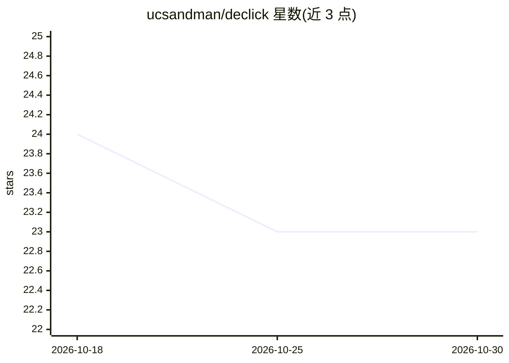

# ucsandman/declick

⭐ 23 · JavaScript · NOASSERTION · 推送 2026-09-08 · [GitHub](https://github.com/ucsandman/declick) · [官网](https://declick.dev) · 个人维护

**将 API/MCP/数据库/网页编译成 agent 可运行 CLI 的编译器**

面向使用编码 agent 的开发者：把 OpenAPI 规范、MCP 服务器、GraphQL、SQLite、CLI 二进制、网页（CDP 浏览器）等十类来源一次性编译为具名动词形式的命令行适配器，模型按需加载单个动词而非在每轮上下文携带全部工具 schema，并统一输出契约（describe 限 2000 字符、--json/--fields/--limit/--where/--dry-run、五种退出码）。支持把多个动词编排为组合动词，setup 命令以快照方式集成进 Claude Code 等并支持逐字节回滚。基准脚本测得 describe 比 9 个真实 MCP 服务器的原始工具列表节省 4.1 倍上下文。零运行时依赖，要求 Node 24 及以上。

## 筛选速览

| 维度 | 判定 | 备注 |
|---|---|---|
| AI 角色 | `ai-ecosystem` | LLM/agent 周边工具 |
| 许可风险 | `none` | NOASSERTION |
| 部署形态 | `library` | 以包/库形式分发 |
| 模型依赖 | — | README 未给出锁定关系 |
| 硬件要求 | — | 无带数字的原话,不猜 |
| 安装摩擦 | `low` | 无编译、无系统依赖或容器化 |
| 成熟度 | — | 结构信号不足 |

## 能力要点

- 十类内置引擎（openapi/mcp/graphql/sqlite/cli/web 等）编译为统一输出契约的 CLI
- describe 输出限 2000 字符，实测较原始 MCP 工具列表减少 4.1 倍上下文
- compose 引擎可将多动词编排为组合动词，支持 --dry-run 与逐步审计
- setup 做字节级快照，--revert 精确回滚对 agent 配置的全部改动

## 适用场景

- 把现有 MCP 服务器转为按需加载的 CLI，降低 agent 上下文占用
- 让 agent 通过 shell 直接调用 REST API、GraphQL 或 SQLite 数据库
- 团队把编译好的适配器放入共享目录或 git 仓库供其他机器复用

## 场景标签

`Agent 框架` · 领域:Agent 开发

## 证据(README 行号)

> L3: A compiler for the interface your agent already has: the shell. MCP makes an agent carry every tool's schema on ever
> L5: The saving is measured, not claimed: against nine real MCP servers (258 tools), the raw tool listing an MCP client p

## 星数曲线

2026-10-18 24 → 2026-10-30 23（-1）

---
*卡片 v1 · prompt 1.4 · 生成 2026-10-27 · 置信度 mid · 依据 README sha `e6518dc60211` · [字段定义](../../DATASET.md)*
