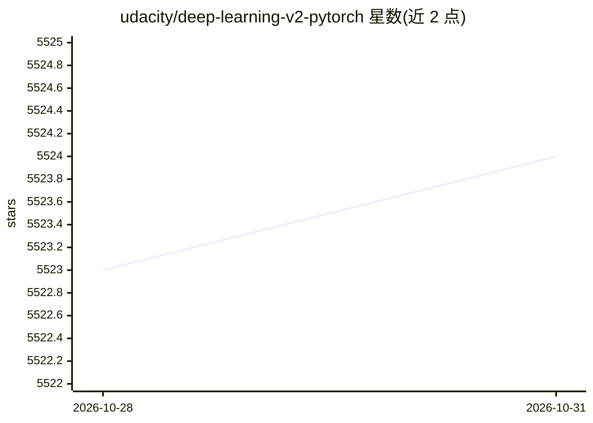

# udacity/deep-learning-v2-pytorch

⭐ 5,524 · Jupyter Notebook · MIT · 推送 2026-10-27 · [GitHub](https://github.com/udacity/deep-learning-v2-pytorch) · 组织维护

**Udacity 深度学习纳米学位的 PyTorch 教程与项目笔记本集**

Udacity Deep Learning Nanodegree (ND101 v7) 配套仓库，提供覆盖神经网络基础、CNN（MNIST/CIFAR10 分类、迁移学习、自编码器、风格迁移）、RNN（时间序列、Word2Vec、情感分析、注意力）、GAN（DCGAN、CycleGAN）及权重初始化/批归一化等主题的 Jupyter 教程笔记本，另有共享单车预测、狗品种分类、电视剧本生成、人脸生成四个项目的起始代码。选修部分含 TensorFlow 与 Keras 入门。通过 git clone 获取，建议用 conda 创建 Python 3.6 环境并安装 PyTorch、torchvision 及 requirements.txt 中的依赖。

## 筛选速览

| 维度 | 判定 | 备注 |
|---|---|---|
| AI 角色 | `ai-knowledge` | 知识聚合/清单类 |
| 许可风险 | `permissive` | MIT |
| 部署形态 | `library` | 以包/库形式分发 |
| 模型依赖 | — | README 未给出锁定关系 |
| 硬件要求 | — | 无带数字的原话,不猜 |
| 安装摩擦 | `low` | 无编译、无系统依赖或容器化 |
| 成熟度 | — | 结构信号不足 |

## 能力要点

- 教程笔记本引导实现 CNN/RNN/GAN 及权重初始化、批归一化等主题
- 四个项目起始代码：自行车租赁预测、狗品种分类、剧本生成、人脸生成
- 迁移学习、风格迁移、CycleGAN 等基于预训练网络的练习
- 含 AWS SageMaker 模型部署课程链接与 TensorFlow/Keras 选修内容

## 适用场景

- 按纳米学位课程进度练习 PyTorch 深度学习实现
- 获取深度学习项目（分类、文本生成、图像生成）的起始代码
- 自学 CNN/RNN/GAN 各主题的入门笔记本

## 场景标签

`教程课程` · 领域:学习与行业

## 证据(README 行号)

> L3: This repository contains material related to Udacity's Deep Learning v7 Nanodegree program. It consists of a bunch o
> L5: There are also notebooks used as projects for the Nanodegree program. In the program itself, the projects are review

## 星数曲线

2026-10-28 5,523 → 2026-10-31 5,524（+1）

---
*卡片 v1 · prompt 1.4 · 生成 2026-10-28 · 置信度 mid · 依据 README sha `b78e7fdfbd1e` · [字段定义](../../DATASET.md)*
