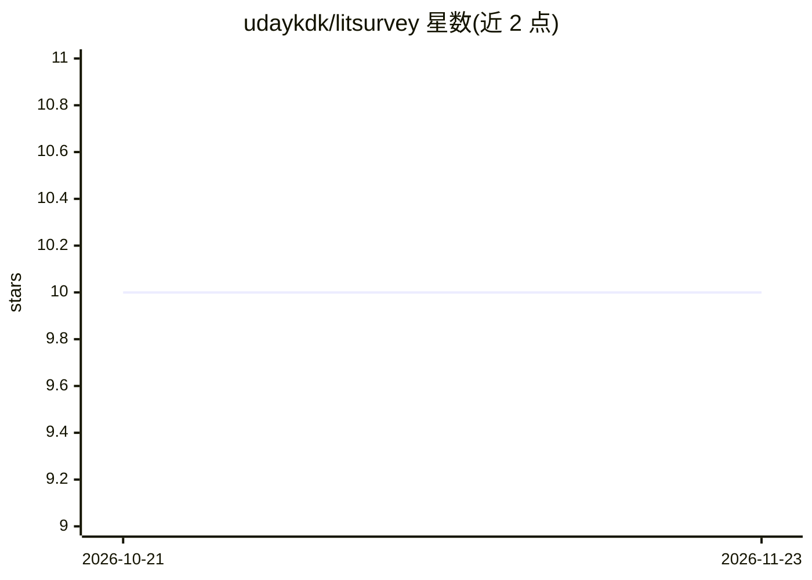

# udaykdk/litsurvey

⭐ 10 · Python · MIT · 推送 2026-10-17 · [GitHub](https://github.com/udaykdk/litsurvey) · 个人维护

**面向科研人员的 LLM 文献综述工具：生成带引文的 SOTA 报告**

一个 Python 包（零运行时依赖，Python 3.10+），将问题交给 LLM 拆解为子问题，跨七个学术索引（OpenAlex、Semantic Scholar、arXiv、PubMed、TechRxiv、Research Square、IACR ePrint）检索，遍历引文图谱并生成按主题组织、带编号引文的综述报告；对报告中的每个 DOI/arXiv id 与检索结果比对以标记来源外引文。另提供 novelty 先行研究判定、引文查询与 BibTeX/RIS/CSV 导出。LLM 后端可选订阅 CLI（Claude Code 等）、Ollama 本地模型或云 API key，并提供浏览器界面。

## 筛选速览

| 维度 | 判定 | 备注 |
|---|---|---|
| AI 角色 | `ai-native` | 本体是模型或模型工具 |
| 许可风险 | `permissive` | MIT |
| 部署形态 | `library` | 以包/库形式分发 |
| 模型依赖 | local-ok | 支持本地模型 |
| 硬件要求 | — | 无带数字的原话,不猜 |
| 安装摩擦 | `low` | 无编译、无系统依赖或容器化 |
| 成熟度 | — | 结构信号不足 |

## 能力要点

- research 模式生成按主题组织、带编号引文的综述，并核验每条 DOI/arXiv id 是否来自检索结果
- novelty 模式对声明给出清晰新颖/增量/已被预见等判定与引文
- LLM 后端支持订阅 CLI、Ollama 本地模型与云 API key，本地模式文本不出机器
- 七个学术数据源融合检索，结果可导出 BibTeX/RIS/CSV/JSON/Markdown

## 适用场景

- 写论文前对某研究问题生成带引文的最新进展综述
- 投稿前核查某个声明是否已有先行研究
- 查找引用某篇论文的文献并导出 BibTeX 到 Zotero/Overleaf
- 保密稿件场景下用本地模型做文献调研

## 场景标签

`科研工具` · 领域:学习与行业

## 证据(README 行号)

> L3: A research assistant for the literature: ask a question, get a cited
> L23: - `research "question"`: the model breaks the question into sub-questions,
> L36:  Codex CLI, Antigravity CLI, Gemini CLI; no API key), **a local model** through Ollama

## 星数曲线

2026-10-21 10 → 2026-11-23 10（+0）

---
*卡片 v1 · prompt 1.4 · 生成 2026-11-19 · 置信度 high · 依据 README sha `43dc78baa0f5` · [字段定义](../../DATASET.md)*
