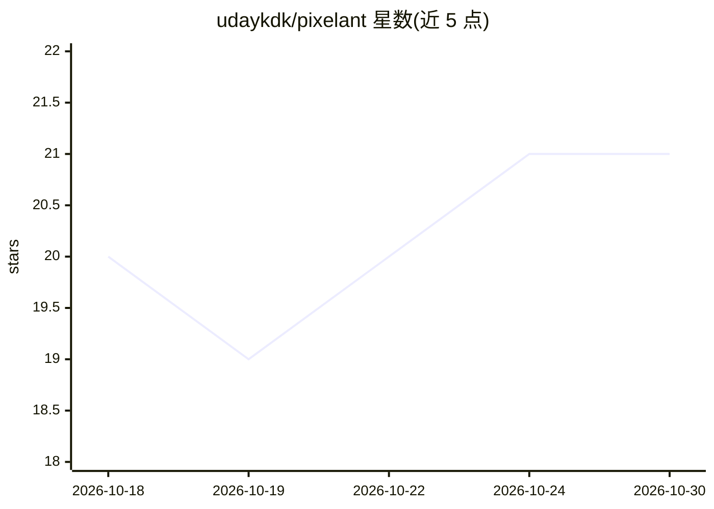

# udaykdk/pixelant

⭐ 21 · Jupyter Notebook · NOASSERTION · 推送 2026-02-11 · [GitHub](https://github.com/udaykdk/pixelant) · 组织维护

**神经网络逆向设计像素化微带天线的科研代码库**

IIT Madras 团队发布的天线逆向设计代码：以 12×12 二值像素表示天线结构，通过串联神经网络（逆向网络+冻结正向 CNN 代理）或 BPSO 进化优化，从目标 S₁₁ 频谱合成单频/多频紧凑天线。包含 MATLAB 数据集生成脚本、Python/Jupyter 训练与推理代码、外链预训练模型与 500k 样本数据集。实现范围为空气与 FR-4 基板、特定频段；算法受印度专利保护，学术用途免费需引用，商用需另获许可。

## 筛选速览

| 维度 | 判定 | 备注 |
|---|---|---|
| AI 角色 | `ai-native` | 本体是模型或模型工具 |
| 许可风险 | `none` | NOASSERTION |
| 部署形态 | `None` |  |
| 模型依赖 | — | README 未给出锁定关系 |
| 硬件要求 | — | 无带数字的原话,不猜 |
| 安装摩擦 | `low` | 无编译、无系统依赖或容器化 |
| 成熟度 | — | 结构信号不足 |

## 能力要点

- 串联架构（逆向网络+冻结正向 CNN）解决逆向设计非唯一性
- 迁移学习将所需介质仿真数据减少 88%（500k→60k 样本）
- 12×12 二值像素参数化，支持 BPSO 进化逆向设计
- 提供 MATLAB 数据生成脚本、Python 训练/推理笔记本与预训练模型

## 适用场景

- 从目标 S₁₁ 频谱快速生成紧凑像素化天线设计
- 生成空气/FR-4 基板天线数据集用于神经网络训练
- 复现 IEEE TAP/JMMCT 论文中的逆向设计方法

## 场景标签

`科研工具` · 领域:学习与行业

## 证据(README 行号)

> L20: This repository provides complete workflows for neural network-based inverse design of pixelated microstrip antenna
> L99: 1. **Inverse Network**: Maps desired S₁₁(f) spectrum → pixelated geometry

## 星数曲线

2026-10-18 20 → 2026-10-30 21（+1）

---
*卡片 v1 · prompt 1.4 · 生成 2026-10-28 · 置信度 high · 依据 README sha `0a6754ef960d` · [字段定义](../../DATASET.md)*
