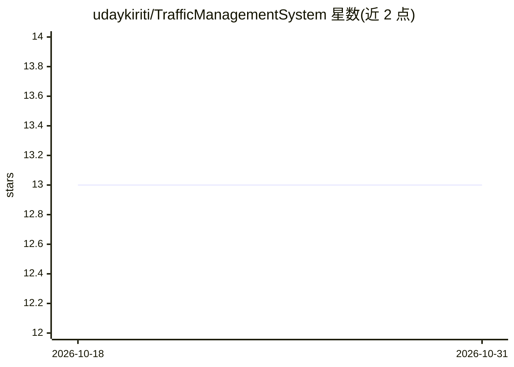

# udaykiriti/TrafficManagementSystem

⭐ 13 · Python · MIT · 推送 2026-03-05 · [GitHub](https://github.com/udaykiriti/TrafficManagementSystem) · 个人维护

**基于视觉与遗传算法的交叉口信号灯自适应调控系统**

端到端城市交通管理系统：从四路摄像头或上传视频读取画面，用 YOLOv4-tiny（OpenCV DNN）检测并按车道统计车辆数，再交由 C++17 实现的遗传算法优化四个方向的绿灯时长，以最小化总等待时间；结果通过 React 面板实时展示，支持 RTSP IP 摄像头流。部署以 Docker/Docker Compose 与 Makefile 为主，也可手动安装：pip 装依赖、下载 YOLO 权重、g++ 编译优化引擎并运行 Flask 与 Node 服务。

## 筛选速览

| 维度 | 判定 | 备注 |
|---|---|---|
| AI 角色 | `ai-native` | 本体是模型或模型工具 |
| 许可风险 | `permissive` | MIT |
| 部署形态 | `self-host` | docker 或自建部署 |
| 模型依赖 | — | README 未给出锁定关系 |
| 硬件要求 | — | 无带数字的原话,不猜 |
| 安装摩擦 | `low` | 无编译、无系统依赖或容器化 |
| 成熟度 | — | 结构信号不足 |

## 能力要点

- YOLOv4-tiny 车辆检测并按车道统计车辆密度
- C++17+OpenMP 遗传算法优化绿灯时长以减少等待时间
- React 实时面板展示交通密度与系统表现
- 支持 RTSP IP 摄像头流与 Docker/Docker Compose 部署

## 适用场景

- 四路交叉口按实时车流动态调整红绿灯配时
- 接入现有 IP 摄像头做交通流量监测与可视化
- 用上传视频文件离线验证信号优化效果

## 场景标签

`目标检测` · 领域:感知与多模态

## 证据(README 行号)

> L9: 2. **Vehicle Detection:** YOLOv4-tiny identifies and counts vehicles in each frame, categorizing them to estimate la
> L10: 3. **Traffic Optimization:** The vehicle counts are passed to a Genetic Algorithm implemented in C++17. This algori

## 星数曲线

2026-10-18 13 → 2026-10-31 13（+0）

---
*卡片 v1 · prompt 1.4 · 生成 2026-10-31 · 置信度 high · 依据 README sha `fa315e6a4339` · [字段定义](../../DATASET.md)*
