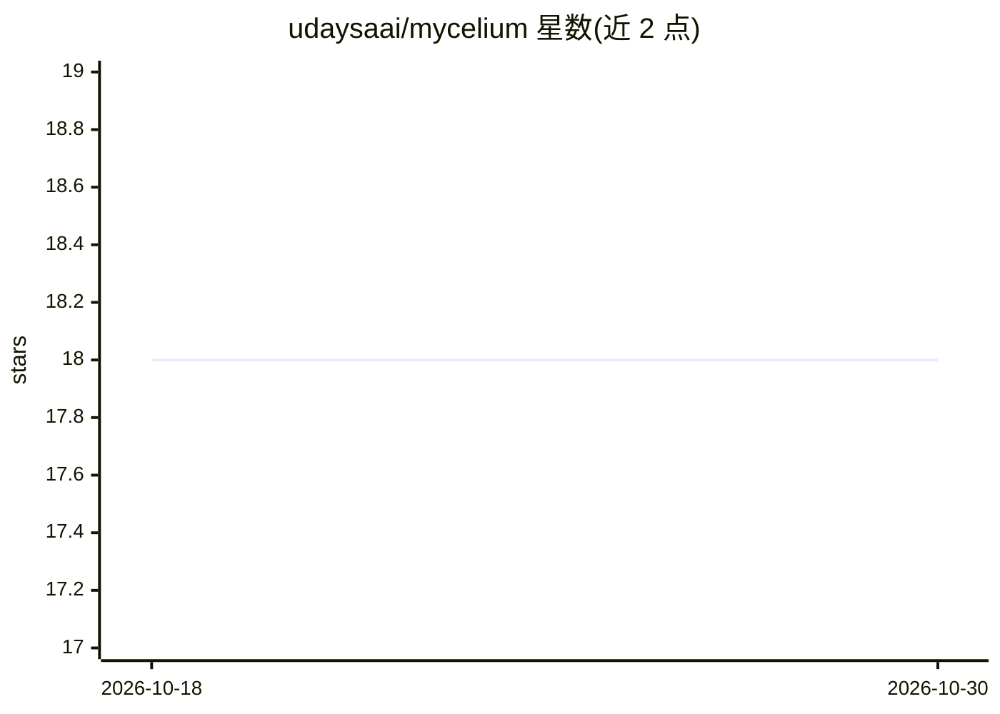

# udaysaai/mycelium

⭐ 18 · Python · MIT · 推送 2026-10-29 · [GitHub](https://github.com/udaysaai/mycelium) · [官网](https://mycelium-agents.netlify.app) · 个人维护

**面向多智能体系统的本地语义路由协议，<10ms 意图发现**

去中心化的 Semantic Edge Routing Protocol：用本地 ChromaDB 向量网格与 all-MiniLM-L6-v2 嵌入，经 FastAPI 将自然语言意图解析到专用 agent 端点，替代云端 LLM 做工具发现与路由。提供 Python 与 JavaScript SDK，附 LangChain 适配器；安全层含 API Key 校验、HMAC-SHA256 签名、最小权限路由与限流。内置 5 个对接真实 API 的演示 agent 节点。以 MIT 许可发布，当前版本 v0.3.0。

## 筛选速览

| 维度 | 判定 | 备注 |
|---|---|---|
| AI 角色 | `ai-ecosystem` | LLM/agent 周边工具 |
| 许可风险 | `permissive` | MIT |
| 部署形态 | `library` | 以包/库形式分发 |
| 模型依赖 | — | README 未给出锁定关系 |
| 硬件要求 | — | 无带数字的原话,不猜 |
| 安装摩擦 | `low` | 无编译、无系统依赖或容器化 |
| 成熟度 | — | 结构信号不足 |

## 能力要点

- 本地 ChromDB 向量网格 + all-MiniLM-L6-v2 实现 <10ms 意图发现
- 提供 Python（mycelium-agents）与 JavaScript（mycelium-js）双 SDK
- 企业安全层：API Key、HMAC 签名、最小权限路由、限流防护
- 内置 5 个对接 OpenWeatherMap/Coingecko 等 API 的演示 agent

## 适用场景

- 大规模 agent 集群中把意图路由从云端 LLM 换到本地
- 多智能体工作流中降低工具发现的延迟与 token 成本
- 用 LangChain 工程接入语义路由做工具选择

## 场景标签

`Agent 框架` `多智能体` · 领域:Agent 开发

## 证据(README 行号)

> L30: ### The Solution: Semantic Edge Routing
> L78: **Python (`mycelium-agents` + LangChain Adapter):**

## 星数曲线

2026-10-18 18 → 2026-10-30 18（+0）

---
*卡片 v1 · prompt 1.4 · 生成 2026-10-29 · 置信度 high · 依据 README sha `cef231378dac` · [字段定义](../../DATASET.md)*
