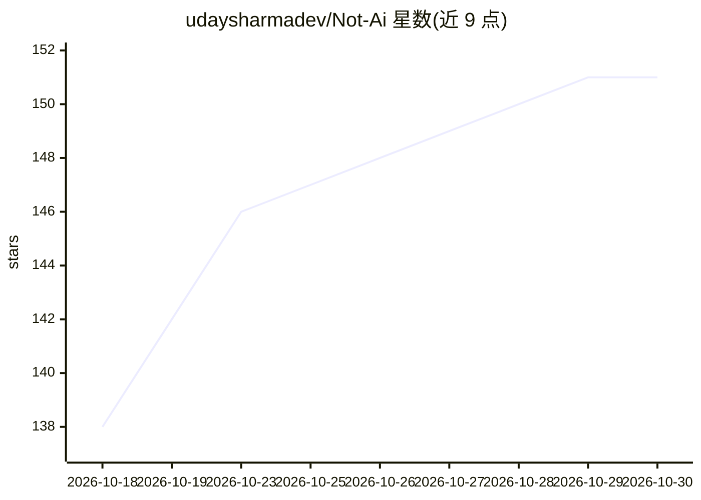

# udaysharmadev/Not-Ai

⭐ 151 · Python · MIT · 推送 2026-10-04 · [GitHub](https://github.com/udaysharmadev/Not-Ai) · 个人维护

**给写作者/学生的 Agent 技能：基于原文的改稿与确定性检查**

以 Agent Skill 形式分发的写作编辑工具，需宿主 agent（Claude Code、Codex、Cursor 等 20+）运行。两层结构：编辑契约层按体裁/受众/目的构建改写规则并维护事实、引文、术语与作者立场的来源台账，缺失信息以括号提示而非编造；另含无依赖的 Python 确定性检查门（gate.py），对排版、词汇层级、句式节奏等给出建议性发现，仅在输出为空或保护字面量缺失时报错。提供 18 种可组合体裁 profile，引用 2025 年 PNAS 语料研究作为编辑依据。明确声明非检测规避工具、非作者身份判定器。

## 筛选速览

| 维度 | 判定 | 备注 |
|---|---|---|
| AI 角色 | `ai-ecosystem` | LLM/agent 周边工具 |
| 许可风险 | `permissive` | MIT |
| 部署形态 | `library` | 以包/库形式分发 |
| 模型依赖 | — | README 未给出锁定关系 |
| 硬件要求 | — | 无带数字的原话,不猜 |
| 安装摩擦 | `low` | 无编译、无系统依赖或容器化 |
| 成熟度 | — | 结构信号不足 |

## 能力要点

- 编辑契约 + 来源台账：事实、引文、术语与作者立场分层保护
- 无依赖 Python 确定性检查门，18 种体裁 profile
- 缺失信息输出括号提示，不编造细节
- 引用 2025 PNAS 语料研究作为编辑证据，附证据登记文档

## 适用场景

- 在 Claude Code / Cursor 等 agent 中改写 LinkedIn 帖、邮件、学术文与技术文档
- 按体裁 profile 做交稿前的确定性检查（gate.py）
- 基于笔记材料生成草稿，缺口以括号标注由作者补齐

## 场景标签

`AI 写作` · 领域:内容生成

## 证据(README 行号)

> L5:  A source-grounded Agent Skill for clear, specific, voice-preserving prose.
> L39: Not Ai has two layers: an editorial contract executed by the host agent, and a
> L55: The host agent reads

## 星数曲线

2026-10-18 138 → 2026-10-30 151（+13）

---
*卡片 v1 · prompt 1.4 · 生成 2026-10-23 · 置信度 high · 依据 README sha `a2632322a78b` · [字段定义](../../DATASET.md)*
